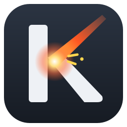
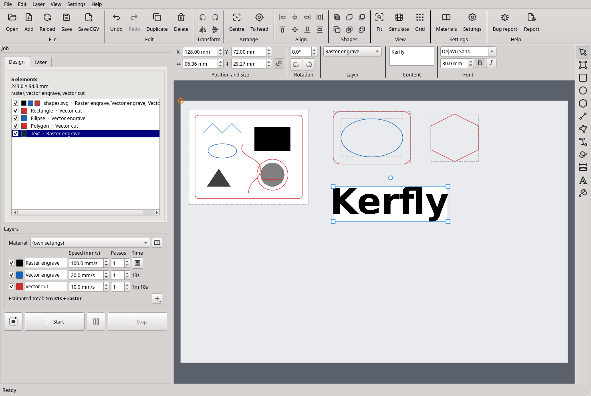

#  Kerfly

[](https://github.com/cyryllo/Kerfly/actions/workflows/tests.yml)

**Website and user guide:** [cyryllo.github.io/Kerfly](https://cyryllo.github.io/Kerfly/) · **Po polsku:** [README_pl.md](README_pl.md) · [instrukcja instalacji](INSTALL_pl.md) · [instrukcja obsługi](https://cyryllo.github.io/Kerfly/pl/guide.html)

Kerfly is laser cutter control software for K40-class CO2 lasers with Lihuiyu
(M2 Nano family) controller boards. It runs on Linux (Debian first) and Windows.

Kerfly is a fork of **[K40 Whisperer](https://www.scorchworks.com/K40whisperer/k40whisperer.html)**
by Scorch (scorchworks.com), version 0.71, which is known for its stable laser
control. The original release is tagged `upstream-0.71` in this repository.



## Status

Early development (0.16). The first test on a real K40 (Windows 10, M3 board)
was done in November 2026; its fixes are in 0.15.0. Kerfly has a new Qt
(PySide6) window. It can open SVG, DXF and G-code files, and bitmap images
(PNG, JPG, BMP, TIFF, GIF, WebP) for raster engraving without Inkscape.

Kerfly has drawing tools in a strip on the right of the bed view, like
LightBurn's: rectangle (with rounded corners), ellipse, regular polygon, line
and text in any installed font. Each shape is cut, engraved as an outline, or
filled as a raster engraving. The **Fill** tool (bucket) fills closed shapes
with engraved patterns (lines, waves, honeycomb, bricks, ...) while their
outline is still cut. Position, size and rotation of the selected element,
and the options of the selected shape or tool (operation, corner radius,
text, font), are shown in a ribbon-style bar above the bed view.

Work is organised in layers, as in LightBurn. Each layer is a raster
engrave, vector (outline) engrave or vector cut with its own speed, passes
and power (M3 boards) and colour, and every element's parts can be put on any
layer of the right kind. A material library (for example "Plywood 3 mm")
stores cut, outline and raster settings and sets all layers at once.

A project (File → Save project, `.kerfly`) keeps the layout, layers, drawn
shapes and copies of the source files in one file, so it can be moved to the
computer at the laser.

Designs are placed on a picture of the laser bed. You can put several files
on the bed, drag them with the mouse, scale and rotate them with handles, or
type their position, size and angle. The editor has undo and redo, a snap
grid, duplicate, centre on the bed and an element list where elements can be
left out of the job. A toolbar with labelled groups (File, Edit, Arrange,
View), in the style of MeerK40t, gives one-click access to the editing
commands. Machine control (connect, home, trace, start, stop) is in the panel
on the left. When a job starts, the laser head first
moves to the design. "Place design at the head" keeps the K40 Whisperer way of
working, where the design starts where the head is, and **Design follows the
head** (the button with a chain link under the unlock button) keeps it there
while you move the head.

It can jog the head, move it to the design corners or to a given position,
and run raster engrave, vector engrave, vector cut, G-code and boundary trace
jobs. It estimates the job time, saves jobs as EGV files and sends existing
EGV files. On M3 boards it also offers test fire and power per operation.
Long jobs run in the background. Pause stops the laser for a moment and the
same button resumes it; Stop ends the job immediately. The K40 does not report
where its head is, so after a Stop Kerfly asks for Home before the next job.
Before anything is sent, Kerfly checks that the head stays on the laser bed
for the whole job, and refuses jobs that would run it into the frame.

The original K40 Whisperer window (`k40_whisperer.py`) is still included and
uses the same core. Batch mode is not in the new window yet.

Planned: the remaining K40 Whisperer features, more file formats, an editor
window and drawing tools. See [ROADMAP.md](ROADMAP.md).

The laser output (EGV data sent over USB) is checked byte-for-byte against the
original 0.71 after every change. See [Regression tests](#regression-tests).

Changes between versions are listed in [CHANGELOG.md](CHANGELOG.md).

## Drawing and editing: mouse and keys

| Action | How |
|---|---|
| Select several elements | Drag a frame around them, or Ctrl+click |
| Move | Drag, or the arrow keys (1 mm or one grid step; Shift: 10×) |
| Snapping | Snaps to corners, centres, middles and lines of other elements, to the bed and to the grid (View → Snap to objects, Ctrl+;) |
| Snap nothing for a moment | **Hold Alt** while drawing, dragging or moving a node |
| Square / circle, 45° lines | Hold Shift while drawing |
| Polyline | Click the corners. Click the first point to close; double-click or Enter for an open line; Backspace removes the last corner; Esc cancels |
| Pen (B) | Click for a corner, press and drag for a smooth curve. Click the first point to close; double-click or Enter to finish; Backspace removes the last node |
| Freehand (F) | Draw with the button held; end near the start to close |
| Measure (M) | Drag between two points: distance, width, height, angle |
| Edit nodes (N) | Drag nodes and round curve handles (Ctrl: one handle alone). Shift+click selects more. Double-click a side to add a node, a node to remove it. Keys: I insert, D delete, L line, C curve, O smooth, S symmetric, Z close / open, B break |
| Edit an opened SVG / DXF | Ungroup it: every line becomes its own shape and the picture splits into its separate parts; click to move, double-click to edit nodes |
| Edit nodes of any element | Double-click it |
| Group / Ungroup | Ctrl+Shift+G / Ctrl+Alt+G. Clicking one member selects the whole group |
| Element list | Shows what is selected on the bed; click a row (Ctrl / Shift: several) to select on the bed |
| Zoom | The wheel zooms in; it does not zoom out further than the whole bed |
| Pan and zoom | Middle or right mouse button drags the view; the wheel zooms |

On KDE Plasma 5, Alt+drag moves windows by default. Change it in System
Settings → Window Management → Window Behavior → Window Actions, or use Plasma
6, where Meta moves windows.

## Installing

See [INSTALL.md](INSTALL.md) ([Polish version](INSTALL_pl.md)). Start Kerfly
with `start_kerfly.bat` on Windows or `./start_kerfly.sh` on Linux. The first
start sets up Python and the libraries.

To check an installation, run `start_kerfly.bat --self-test` (Windows) or
`./start_kerfly.sh --self-test` (Linux). It reports the libraries, the USB
driver, whether a K40 is connected (without moving it), Inkscape, the
settings folder, and whether the window opens a design. Please include its
output in bug reports.

## Reporting problems

In Kerfly choose **Help → Report a problem on GitHub…** (or the **Bug report**
button). Kerfly saves a diagnostic report (settings, self-test and the log of
what was sent to the laser) and opens the
[report form](https://github.com/cyryllo/Kerfly/issues/new/choose) with the
version, system and board filled in; drag the report file into the form.
There are forms for laser problems (wrong place, power or speed), other bugs,
feature ideas and translation fixes. You can write in English or Polish.

## Running from source (Debian / Ubuntu)

```bash
sudo apt install python3-venv python3-tk inkscape
python3 -m venv .venv
.venv/bin/pip install -r requirements.txt -r requirements-optional.txt
.venv/bin/python kerfly.py               # new window
.venv/bin/python k40_whisperer.py        # original K40 Whisperer window
```

Inkscape is optional. It is used for SVG rasters when it is installed (as in
K40 Whisperer), and it is needed for SVG text that is cut or engraved as an
outline. Without it, Kerfly renders SVG rasters with its built-in renderer.

USB access without root needs a udev rule. See [README_Linux.txt](README_Linux.txt).

## Running from source (Windows)

Install Python 3.13 (Inkscape is optional), then run
`pip install -r requirements.txt` and `python kerfly.py`. The laser needs the libusb-win32 driver, which you
can install with [Zadig](https://zadig.akeo.ie/).

## Languages

Kerfly is available in English, Polish, German, Spanish and French. It uses
the system language by default. You can change it in Settings → Advanced →
Language.

The German, Spanish and French translations have not yet been reviewed by
native speakers. Corrections are welcome.

To translate Kerfly into another language or correct a translation:

1. Install the developer tools: `pip install -r requirements-dev.txt`
2. To add a language, add its code to `LANGUAGES` in `kerfly/i18n.py` and run
   `python tools/i18n.py`. This creates
   `kerfly/locale/<code>/LC_MESSAGES/kerfly.po`.
3. Translate the `.po` file, for example with [Poedit](https://poedit.net/).
4. Run `python tools/i18n.py` to compile it, then `python tests/test_i18n.py`
   to check it.

Developers: wrap every user-visible string in `_()`, or use `N_()` for strings
in tables that are translated later. Then run `python tools/i18n.py`.

## Project layout

- `kerfly/core/`: the GUI-independent laser core. It contains the SVG, DXF
  and G-code loaders, settings file handling, design data, raster
  preparation, path ordering and EGV job generation. Nothing in it imports a
  GUI toolkit.
- `kerfly/gui/`: the new PySide6 interface. Start it with `kerfly.py`.
- `k40_whisperer.py`: the original Tkinter interface. It now calls
  `kerfly.core`.
- `egv.py`, `nano_library.py`: EGV encoding and USB communication with the
  controller board. These are unchanged from K40 Whisperer.
- `tests/`: regression tests.

## Regression tests

```bash
.venv/bin/python tests/test_core.py          # core only, no display needed
.venv/bin/python tests/test_gui.py           # new window, offscreen
.venv/bin/python tests/test_i18n.py          # translations complete and up to date
sudo apt install xvfb
xvfb-run -a .venv/bin/python tests/regression.py   # full application
```

There are 25 test cases. They cover vector cut, vector engrave, raster, trace
and G-code jobs, M1/M2/M3/B1 boards, rotate, mirror, home in upper right and
multiple passes. Each case compares the exact bytes the laser would receive
with the baseline produced by the unmodified 0.71. M3 power mode is captured
through a fake USB device. SVG-based baselines depend on the Inkscape version
(currently 1.4). Without Inkscape, those cases are skipped.

GitHub Actions runs every push on clean Windows and Ubuntu machines. It
installs Kerfly with `start_kerfly.bat` / `start_kerfly.sh`, runs the
self-test, and then runs all the test suites above. These machines have no
Inkscape, so the SVG-based cases are skipped there. All the other laser output
is checked byte-for-byte on Windows as well.

## License

Kerfly is free software, distributed under the **GNU General Public License,
version 3 or later** (GPL-3.0-or-later). See [LICENSE](LICENSE).

- Copyright (C) 2017–2026 Scorch: the original K40 Whisperer.
- Copyright (C) 2026 Kerfly contributors: changes made in this fork.

Some files come from other projects (Inkscape extensions, a MIT-licensed speed
code library, small snippets from public websites) and keep their own notices.
[THIRD-PARTY-NOTICES.md](THIRD-PARTY-NOTICES.md) lists each file, its author
and its license.

## Credits and disclaimer

All credit for the laser control core goes to **Scorch**, the author of
K40 Whisperer. Kerfly is an independent fork. It is not affiliated with or
endorsed by Scorch or scorchworks.com. Please report Kerfly bugs here, not to
the K40 Whisperer author.

This program controls a laser. It is provided WITHOUT ANY WARRANTY (see
sections 15–16 of the GPL). Never leave a running laser unattended.
