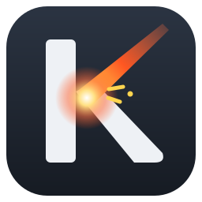
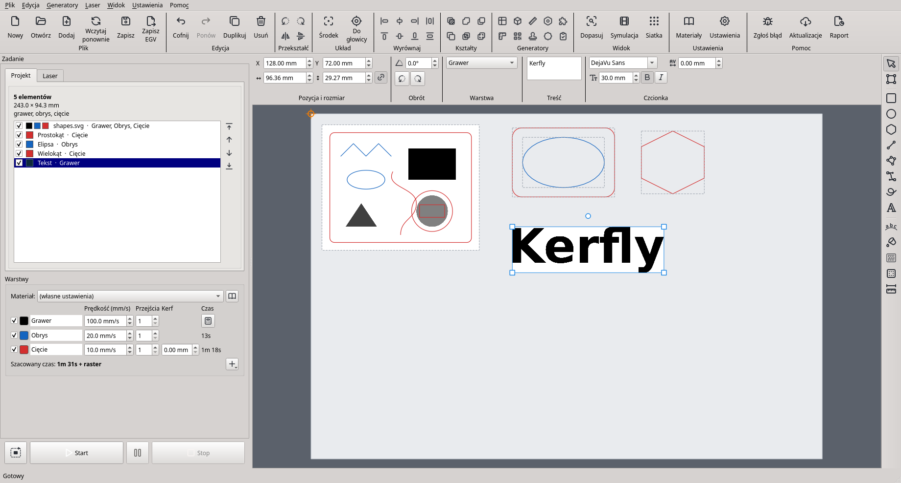

#  Kerfly

**Strona i instrukcja obsługi:** [cyryllo.github.io/Kerfly/pl](https://cyryllo.github.io/Kerfly/pl/) · **Pobierz:** [najnowsze wydanie](https://github.com/cyryllo/Kerfly/releases/latest) · **English:** [README.md](README.md)

Kerfly to darmowy program do sterowania laserami CO2 klasy K40 z płytami
Lihuiyu (rodzina M2 Nano). Działa na Windows 10 / 11 i Linuksie.

## Instalacja

Pobierz paczkę dla swojego systemu z
[najnowszego wydania](https://github.com/cyryllo/Kerfly/releases/latest):

- **Windows 10 / 11:** uruchom `Kerfly-<wersja>-windows-setup.exe`.
  Instalator nie jest podpisany, więc Windows może pokazać „System Windows
  ochronił ten komputer”: wybierz **Więcej informacji → Uruchom mimo to**. Za
  pierwszym razem zaznacz sterownik USB lasera K40.
- **Linux:** nadaj plikowi `Kerfly-<wersja>-x86_64.AppImage` prawo
  uruchamiania i uruchom go. Raz dodaj regułę dla portu USB lasera (trzy
  polecenia, zobacz [INSTALL_pl.md](INSTALL_pl.md#linux-appimage)).

Krok po kroku, z autotestem i pierwszym uruchomieniem z laserem:
[INSTALL_pl.md](INSTALL_pl.md). Jak używać Kerfly: [instrukcja
obsługi](https://cyryllo.github.io/Kerfly/pl/guide.html).

## Co potrafi

- **Układanie na stole.** Kilka plików na obrazie stołu lasera: przesuwanie,
  skalowanie i obracanie myszą albo wpisanie pozycji, rozmiaru i kąta.
  Wyrównywanie, grupowanie, łączenie kształtów, kolejność zadania, cofanie i
  ponawianie wszystkiego.
- **Rysowanie i edycja.** Prostokąt (także z zaokrąglonymi rogami), elipsa,
  wielokąt, linia, łamana, pióro (krzywe), rysowanie odręczne i tekst dowolną
  zainstalowaną czcionką, także wzdłuż linii, krzywej albo okręgu. Edycja
  węzłów narysowanych kształtów i otwartych plików SVG i DXF.
- **Wzory i zawiasy.** Narzędzie **Wypełnienie** wypełnia zamknięte kształty
  grawerowanymi wzorami (linie, fale, plaster miodu, cegły…), a ich obrys
  nadal jest cięty. Narzędzie **Zawias giętki** nacina zawiasy, dzięki którym
  sklejka się wygina.
- **Warstwy jak w LightBurnie.** Grawer rastrowy, obrys i cięcie, każda z
  własną prędkością, liczbą przejść, mocą (płyty M3) i kolorem. Baza
  materiałów (np. „Sklejka 3 mm”) ustawia wszystkie warstwy jednym wyborem.
- **Pliki.** SVG, DXF, G-code i obrazy (PNG, JPG, BMP, TIFF, GIF, WebP) do
  graweru rastrowego. Projekt (`.kerfly`) trzyma układ, warstwy, kształty i
  kopie plików źródłowych w jednym pliku.
- **Praca z laserem.** Połączenie, bazowanie, przesuwanie głowicy, objazd
  konturu, symulacja i czas zadania, pauza i wznowienie, stop. Projekt
  zostaje na swoim miejscu na stole i głowica do niego podjeżdża, albo
  projekt podąża za głowicą: jak wolisz. Kerfly nie wyśle zadania, które
  wyprowadziłoby głowicę poza stół.
- **Twój język.** Polski, angielski, niemiecki, hiszpański i francuski
  (Ustawienia → Zaawansowane → Język).

Kerfly jest we wczesnej fazie rozwoju (0.19). Jest sprawdzany na prawdziwym
K40 (Windows 10, płyta M3). Zmiany są w [CHANGELOG.md](CHANGELOG.md), plany w
[ROADMAP.md](ROADMAP.md) (po angielsku).

## Rysowanie i edycja: mysz i klawisze

| Czynność | Jak |
|---|---|
| Zaznaczenie kilku elementów | Przeciągnij wokół nich ramkę albo Ctrl+klik |
| Przesuwanie | Przeciągnij albo strzałki (1 mm albo jedno oczko siatki; Shift: 10×) |
| Przyciąganie | Do narożników, środków, połówek i linii innych elementów, do stołu i do siatki (**Widok → Przyciągaj do obiektów**, Ctrl+;) |
| Chwilowo bez przyciągania | **Przytrzymaj Alt** przy rysowaniu, przeciąganiu albo przesuwaniu węzła |
| Kwadrat / koło, linie co 45° | Przytrzymaj Shift przy rysowaniu |
| Łamana | Klikaj narożniki. Kliknij pierwszy punkt, żeby zamknąć; dwuklik albo Enter kończy otwartą linię; Backspace usuwa ostatni narożnik; Esc anuluje |
| Pióro (B) | Klik daje narożnik, wciśnięcie i przeciągnięcie daje gładką krzywą. Kliknij pierwszy punkt, żeby zamknąć; dwuklik albo Enter kończy; Backspace usuwa ostatni węzeł |
| Odręcznie (F) | Rysuj z wciśniętym przyciskiem; skończ blisko początku, żeby zamknąć kształt |
| Miarka (M) | Przeciągnij między dwoma punktami: odległość, szerokość, wysokość, kąt |
| Edycja węzłów (N) | Przeciągaj węzły i okrągłe uchwyty krzywych (Ctrl: jeden uchwyt osobno). Shift+klik zaznacza więcej. Dwuklik na boku dodaje węzeł, na węźle go usuwa. Klawisze: I wstaw, D usuń, L linia, C krzywa, O gładki, S symetryczny, Z zamknij / otwórz, B rozdziel |
| Edycja otwartego SVG / DXF | Rozgrupuj go: każda linia staje się osobnym kształtem, a obraz dzieli się na osobne części; klik przesuwa, dwuklik edytuje węzły |
| Edycja węzłów dowolnego elementu | Dwuklik na nim |
| Grupuj / Rozgrupuj | Ctrl+Shift+G / Ctrl+Alt+G. Klik w jeden element grupy zaznacza całą grupę |
| Lista elementów | Pokazuje, co jest zaznaczone na stole; klik w wiersz (Ctrl / Shift: kilka) zaznacza na stole |
| Powiększenie | Kółko myszy przybliża; nie oddala bardziej niż cały stół |
| Przesuwanie i powiększanie widoku | Środkowy albo prawy przycisk myszy przesuwa widok; kółko przybliża |

W KDE Plasma 5 Alt+przeciąganie domyślnie przesuwa okna. Zmienisz to w
Ustawieniach systemowych → Zarządzanie oknami → Zachowanie okien → Działania
okien. W Plasmie 6 okna przesuwa się klawiszem Meta.

## Zgłaszanie problemów

W Kerfly wybierz **Pomoc → Zgłoś problem na GitHubie…** (albo przycisk **Zgłoś
błąd**). Kerfly zapisze raport diagnostyczny (ustawienia, autotest i dziennik
tego, co poszło do lasera) i otworzy
[formularz zgłoszenia](https://github.com/cyryllo/Kerfly/issues/new/choose) z
wpisaną wersją, systemem i płytą. Przeciągnij plik raportu do formularza. Są
formularze dla problemów z laserem (złe miejsce, moc albo prędkość), innych
błędów, pomysłów na funkcje i poprawek tłumaczeń. Formularze są po angielsku,
ale **zgłoszenie możesz napisać po polsku**.

## Licencja

Kerfly jest wolnym oprogramowaniem na licencji **GNU General Public License w
wersji 3 lub późniejszej** (GPL-3.0-or-later). Zobacz [LICENSE](LICENSE).

- Copyright (C) 2017–2026 Scorch: oryginalny K40 Whisperer.
- Copyright (C) 2026 Kerfly contributors: zmiany wprowadzone w tym forku.

Niektóre pliki pochodzą z innych projektów i mają własne informacje o
licencji. [THIRD-PARTY-NOTICES.md](THIRD-PARTY-NOTICES.md) wymienia każdy
plik, jego autora i licencję.

Ten program steruje laserem. Jest dostarczany BEZ JAKIEJKOLWIEK GWARANCJI
(zobacz punkty 15–16 licencji GPL). Nigdy nie zostawiaj pracującego lasera bez
nadzoru.

---

Kerfly jest niezależnym forkiem [K40 Whisperera](https://www.scorchworks.com/K40whisperer/k40whisperer.html)
autorstwa Scorcha, który napisał jego rdzeń sterowania laserem. Nie jest ze
Scorchem związany ani przez niego popierany; problemy z Kerfly zgłaszaj tutaj.
Dla programistów (uruchamianie ze źródeł, testy, tłumaczenia, paczki):
[DEVELOPMENT.md](DEVELOPMENT.md) (po angielsku).
