# Kerfly user guide

Kerfly controls K40-class CO2 lasers with Lihuiyu (M2 Nano family) boards:
it places your designs on the laser bed, lets you draw and edit them, and
sends the job to the laser. This guide is for version 1.4.

> Always keep a hand near the laser's power switch, and never leave a
> running laser unattended.

- [1. First start](#s1)
- [2. The window](#s2)
- [3. Moving the laser head](#s3)
- [4. Opening files](#s4)
- [5. Drawing and editing](#s5)
- [6. Layers and materials](#s6)
- [7. Running a job](#s7)
- [8. Settings](#s8)
- [9. Keyboard shortcuts](#s9)
- [10. When something goes wrong](#s10)

## 1. First start

1. Install Kerfly as described in the
   [installation guide](https://github.com/cyryllo/Kerfly/blob/main/INSTALL.md),
   from the [releases page](https://github.com/cyryllo/Kerfly/releases):
   - **Windows 10 / 11:** run `Kerfly-<version>-windows-setup.exe`. The
     installer is not signed, so Windows may say "Windows protected your PC":
     choose **More info → Run anyway**. The first time, tick the USB driver
     for the K40 laser.
   - **Linux:** make `Kerfly-<version>-x86_64.AppImage` executable and run
     it. Allow the laser's USB port once: **Laser → Allow USB access for the
     laser…** (asks for your password), then plug the laser in again.
   - **macOS** (preview): open the `.dmg` and drag Kerfly to Applications;
     the first start goes through **System Settings → Privacy & Security →
     Open Anyway** (the installation guide shows it). USB needs no driver.
2. Check the installation with the self-test (in a command window /
   terminal):
   - Windows installer: `"C:\Program Files\Kerfly\kerfly-console.exe" --self-test`
   - AppImage: `./Kerfly-<version>-x86_64.AppImage --self-test`
   - macOS: `/Applications/Kerfly.app/Contents/MacOS/Kerfly --self-test`

   Every line should say `OK`; `WARN` lines are optional parts or mean that
   the laser is not connected.
3. Open **Settings → Lasers…** and choose your laser's **Controller board**
   (printed on the board, for example LASER-M2 or LASER-M3) and its **bed
   size**, then **Save**. The **units** (mm or inches) are in **Settings →
   Settings… → View**.
4. Switch the laser on, connect the USB cable and press the **plug** button
   (Connect, Ctrl+I) on the **Laser** tab. By default Kerfly then homes the
   head (moves it to the upper left corner).

Kerfly keeps its settings in `k40_whisperer.txt` in your home folder.
**File → Save settings as default** keeps changed settings. The language,
the grid, snapping and "design follows the head" are kept at once, without
saving.

## 2. The window

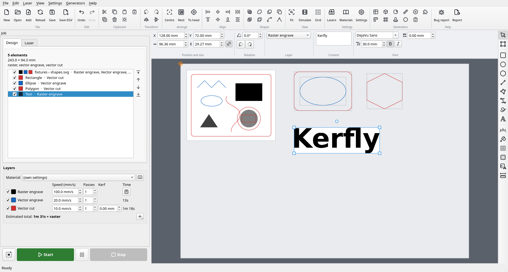

- **Ribbon** (top), in labelled groups: **File** (New, Open, Add, Save; small
  buttons for Reload, Save EGV and G-code), **Edit** (Undo, Redo; the
  clipboard, duplicate, delete, select all, group, edit nodes), **Arrange** (align,
  distribute, turn, mirror, centre, nest, to head), **Shapes** (combine,
  join), **View** (Fit, Simulate, Grid) and **Tools** (**Generators** with a
  list of all generators, Materials, Settings). Hold the mouse over a small
  button to see what it does. Reporting a problem is in the **Help** menu.

  

- **Options bar** (under the ribbon, across the window), two rows: the first
  always shows the **selection**: its position (X, Y), size (W, H, the chain
  keeps the proportions), rotation and **Layer**; the second the options of
  what is edited, its name in bold on the left (for example the text, its
  font, size and letter spacing). Every field has an icon, a short caption and
  a tooltip. Changes show at once, each one an undo step (Ctrl+Z
  takes it back); the tools' windows have their own Cancel. When a row does not fit the window, its fields go on
  in the next line.

  

- **Left panel**: the **Design** tab lists the **Elements** (with their number
  and size; red when the design sticks out of the bed) and the **Layers**; the
  **Laser** tab has the laser in use and moves the head. At the bottom, on both
  tabs, the job's buttons: **Trace**, **Start**, **Pause** and **Stop**.
- **Status bar** (bottom): messages, where the mouse pointer is on the bed
  (from home, like the X and Y fields), the bed's size, the zoom (100 %: the
  whole bed) and whether the laser is connected.
- **Bed view** (middle): the laser bed with your elements. The orange
  crosshair is the laser head. Elements that stick out of the bed are drawn
  red, and the job cannot start until they are moved back.
- **Tools** (right), in three groups: select (Edit nodes is in the ribbon's Edit group); drawing
  (rectangle, ellipse, polygon, line, polyline, pen, freehand, text); and
  operations on shapes (text on a path, fill with a pattern, living hinge,
  measure).

Mouse in the bed view: the wheel zooms in and out (not further than the
whole bed); the middle or right button drags the view; **Ctrl+0** fits the
bed to the window. A **right click** (without dragging) opens a menu: on an
element its commands (copy, cut, paste, duplicate, delete, group, **Layer** ▸
to move all selected elements to another layer at once, combine shapes,
offset, order, align, turn, mirror, fill, edit nodes, centre, leave out of
the job); on the empty bed **Move the head here** (laser connected), paste,
select all, fit, grid.

## 3. Moving the laser head

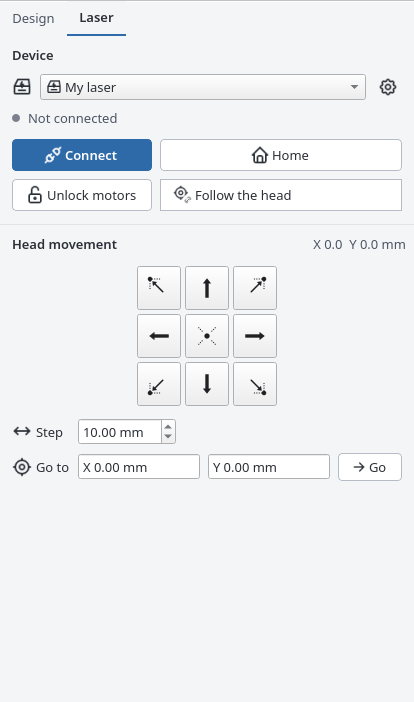

The **Laser** tab has the **Device** (the laser in use, whether it is
connected, the machine's buttons) and the **Head movement** (the jog pad, the
step, go to X / Y). At its top, the list of **your lasers**: with two lasers (for example
a laptop taken from one to the other), choose the one you work with, and its
settings (board, bed size, home corner, scale, power, rotary, trace, programs
before and after a job) go into the window. The cog next to the list (or
**Settings → Lasers…**) opens **your lasers and their settings**: the list on
the left (New, Duplicate, Import), the selected laser's name (type a new one
and press Enter) and its settings on the right, Export and Delete under them. Change
any laser there, also one not in use: the changes are kept while you go from
one laser to another, **Save** writes them (the laser in use's go into the
window at once), **Cancel** leaves them, **Use this laser** works with the
selected one. One laser is used at a time.
**Two lasers plugged into one computer** (beta): Settings → Lasers… → **USB
port** keeps the port of each laser's board in its profile (**Which one?**
moves that laser's head a little to the right and back). Without a remembered
port, when two are plugged in, Kerfly asks which one to connect to and
remembers the answer. On Linux the port stays the same as long as the cable
stays in the same socket; on Windows Kerfly may ask again after a replug or a
restart.

| Button | What it does |
|---|---|
| Plug (left of the arrows) | **Connect** to the laser (Ctrl+I); the plug and the dot under the laser list turn green |
| House | **Home**: move the head to the home corner |
| Open lock | **Unlock motors**: release them so the head can be moved by hand |
| Crosshair with a chain link | **Design follows the head** (Ctrl+Alt+H, pressed when on), see below |
| Arrows | Move the head by one **Step** (the field under the pad). **Ctrl+arrow keys** do the same from the keyboard |
| Dotted corners and centre | Move the head to that corner or the centre of the design, to see where it will be cut. The design does not move. Ctrl+7, Ctrl+9, Ctrl+5, Ctrl+1, Ctrl+3 |
| Go to X / Y, **Go** | Home, then move the head to that position (distance from the home corner; Ctrl+Alt+G) |

The plain arrow keys (without Ctrl) move the **selected element** on the bed,
not the head.

**Where the job starts.** The design stays where it is on the bed (as in
LightBurn or MeerK40t): when a job starts, the head first drives to the
design. To start the design where the head is instead:

- **Edit → Place design at the head** (Ctrl+H, **To head** in the Arrange group of the ribbon) moves the
  design to the head once: its corner at the laser's home corner goes to the head (the lower left for a
  laser homing to the lower left; Settings → Lasers… → Home corner).
- **Design follows the head** (the button with the chain link, pressed
  when on) keeps the design at the head: the arrows, Go to X/Y and Home move the
  head and the design together, and the arrows do not push the design off
  the bed. The corner buttons still only move the head; after one, the arrows
  move the design with the head, which keeps its place on the design (for
  example its upper left corner, to check the design against the edge of the
  material).

The K40 does not report where its head is. Kerfly counts the moves it sends;
after the motors were unlocked, the head was moved by hand, or a job was
stopped, press **Home** before the next job. After a stopped job Kerfly says
so in the status bar.

## 4. Opening files

**File → New project** (Ctrl+N, **New** on the ribbon) starts with an empty bed
and the default layers (it asks to save unsaved changes first).
**File → Open design…** (Ctrl+O) replaces everything on the bed;
**File → Add design…** (Ctrl+Shift+O) puts another file next to the others.

| File | What becomes of it |
|---|---|
| SVG | Red lines are cut, blue lines engraved as outlines, everything else (fills, pictures, black lines) is raster engraved. Inkscape is used when installed, otherwise the built-in renderer; Inkscape is needed for SVG text that is cut or engraved as an outline |
| DXF | Cut lines; blue entities and layers named *engrave* become outline engraving |
| PNG, JPG, BMP, TIFF, GIF, WebP | Raster engraving: dark pixels are engraved. Kerfly shows the image size; set the resolution or the width and height. **Trace picture** (the button of a selected picture, or Edit → Trace picture…) turns its dark areas into paths over it, to cut, outline, fill with a pattern or edit node by node: set the threshold, ignore specks, detail and smooth curves while the outlines show over the picture |
| G-code (.ngc, .gcode, .nc, .g, .tap) | Run as G-code |
| Kerfly project (.kerfly) | The whole layout, layers and drawn shapes |

**File → Save project** (Ctrl+S) saves the layout, the layers, the drawn
shapes and copies of the opened files in one `.kerfly` file, so it can be
moved to the computer at the laser. **Reload design** (F5) reads the opened
files again after you changed them in another program.

## 5. Drawing and editing

Choose a tool on the right (or press its key), then draw on the bed with the
mouse. The options of the tool are in the options bar; you can change them
before or after drawing.

| Tool | Key | How |
|---|---|---|
| Select and move | S | Click to select, drag to move; the corner handles scale, the handles in the middles of the sides stretch the width or the height alone (the opposite side stays), the round one rotates. Drag a frame around several elements, or Ctrl+click |
| Edit nodes | N | Drag nodes and the round curve handles (Ctrl: one handle alone). Double-click a side to add a node, a node to remove it. Keys: I insert, D delete, L line, C curve, O smooth, S symmetric, Z close / open, B break. A click on the empty bed ends it (back to Select) |
| Rectangle | R | Drag. Shift: square. Option: corner radius |
| Ellipse | E | Drag. Shift: circle |
| Polygon | P | Drag. Option: number of sides |
| Line | L | Drag. Shift: steps of 45° |
| Polyline | Shift+L | Click the corners. Click the first point to close; double-click or Enter for an open line; Backspace removes the last corner; Esc cancels |
| Pen (curves) | B | Click for a corner, press and drag for a smooth curve. Click the first point to close; double-click or Enter to finish |
| Freehand | F | Draw with the button held; end near the start to close the shape |
| Measure | M | Drag between two points: distance, width, height and angle |
| Text | T | Click where the text goes: the **Text** window opens (the text, font, size, bold, italic, letter spacing, with a preview); **Insert the text**. At the top of the font list: **single-line fonts** built into Kerfly (Hershey, EMS), whose letters are lines the laser runs along once: fast, fine engraving, nothing to fill. Double-click a text (or **Edit text…** in the options bar) to change it |
| Text on a path | Shift+T | Click a line, curve or shape: the text goes on it and its window opens (see below) |
| Fill with a pattern | Shift+F | Click a closed shape (or choose the tool with shapes selected): the **Fill** window opens (see below) |
| Living hinge | Shift+H | Click a closed shape (or choose the tool with shapes selected): the **Living hinge** window opens (see below) |
| Offset | Shift+O | Click a closed shape (or choose the tool with shapes selected): the **Offset** window opens (see below) |
| Cut out of a picture | Shift+C | Drag a rectangle or an ellipse (options bar) over a picture: the piece inside stays where it is, the rest of the picture goes (Undo brings it back) |

**Snapping.** Drawing and moving snap to the corners, centres and edges of
other elements and to the bed (**View → Snap to objects**, Ctrl+;), and to
the grid when it is on (**View → Snap to grid**, Ctrl+'; **View → Grid
size**). Hold **Alt** to snap to nothing for a moment. Kerfly remembers the
grid (on or off, and its size), snapping to objects and **Design follows the
head** by itself for the next start; they can also be set in **Settings →
View**.

**Moving precisely.** Type the position, size and angle in the options bar
(the chain button keeps the proportions), or use the arrow keys: 1 mm or one
grid step, with Shift 10 times as far.

**Arranging.** The **Edit** menu and the ribbon have: undo and redo
(Ctrl+Z, Ctrl+Shift+Z), copy, cut and paste (Ctrl+C, Ctrl+X, Ctrl+V: pasted at
the mouse pointer, also into another project; Ctrl+Alt+V pastes in place),
select all (Ctrl+A), duplicate (Ctrl+D), delete (Del), rotate 90°
(Ctrl+L, Ctrl+R), mirror (Ctrl+Shift+H, Ctrl+Shift+V), centre on the bed
(Ctrl+E), align and distribute, and **Combine shapes**: union, difference,
intersection and exclusion of closed shapes (difference: the other selected
shapes are cut out of the one highest in the element list).

**Join into a polyline** (Ctrl+J, Edit menu, Shapes group of the ribbon,
right-click menu): the selected lines, polylines and open paths whose ends
meet (closer than 0.05 mm) become one path, cut in one go; a chain that
comes round is closed. Useful for drawings made of loose pieces (from DXF
files): on a GRBL laser or a CNC machine every piece makes the machine slow
down and speed up again. Closed outlines and lines that meet nothing stay as
they are. An opened file: Ungroup it first.

**Nest on the bed** (Ctrl+Shift+N, **Nest** in the Arrange group of the
ribbon, Edit menu, right-click menu): the selected parts (nothing selected:
all of them; a group as one part; with only some selected, **Parts:
Selected / All** in the dialog — All when a single part is selected) are laid out on the laser's bed, a set
**gap** apart, turned by 90° where that fits better (switch **Turn by 90°**
off for wood grain). **Method**: **Rectangles** packs the rectangles around
the parts (fast); **Outlines** (beta) packs their real outlines, so parts go
into each other's gaps and into the holes cut in them (only cut lines make a
hole: an engraving inside a part stays the part's), with the sparrow
library; it searches for a tighter layout for the **search time** you set
(for each sheet, then half of it more to pack the sheet's parts together into
its upper left corner; a window shows it, Cancel leaves everything as it
was). What
does not fit goes on a next sheet (a sheet is always the bed): each sheet is
a group in the element list, sheets 2 and on unticked; cut sheet 1, then
untick it and tick the next one. Nesting again lays the parts out anew.

**The tools' windows.** Fill, Living hinge, Offset, Text and Text on a path
are set up in a window: on the left a **preview of your shape** that follows
every change, on the right the kinds as tiles with pictures and the fields
(each with an icon and a tooltip), at the bottom **Cancel** and the action
named for what it does (**Fill it**, **Cut the hinge**, **Offset**, **Insert
the text**), and on the left a **Remove** button where there is something to
remove. Nothing changes on the bed before the action is clicked; it is one
undo step. The options bar keeps the quick things (position, size, rotation,
layer, corners, bridges) and has buttons for the windows of the shape shown.

**Offset.** The **Offset** tool (Shift+O, also Edit → Offset) draws a new
outline a set distance around a shape. Click a closed shape (or choose the
tool with shapes selected): in the **Offset** window choose round or sharp
**corners** (tiles), the **distance** (positive outside, holes get smaller;
negative inside) and **Keep the shape** (off: the new outline replaces it);
the preview shows the shape dashed and the new outline in red. Use it for a
border around a text, a frame around a part, or a smaller copy inside.

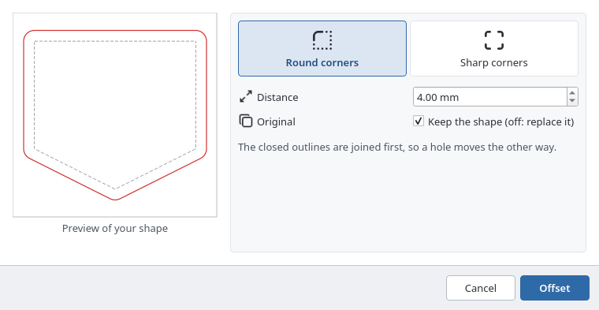

**Order.** The element list is the order of the job: within each layer the
laser does the element at the top of the list first. (The layers themselves
always run in the order raster engraving, outline engraving, cutting.) Inner
shapes are always cut before the outer ones, so a part does not fall out
before its holes are cut: inside one element, and also when a shape lies
inside another element's cut (a circle drawn after the square it sits in). The arrow buttons beside the
element list (Design tab) move the selected elements: **Move up (earlier)**
and **Move down (later)** one place (PgUp, PgDown while the bed view has the
focus), **To the start** and **To the end** to the top or the bottom of the
list (Ctrl+PgUp, Ctrl+PgDown).
Groups move together.

**Groups.** **Group** (Ctrl+G) makes several elements move together;
clicking one member selects the whole group, a second click selects that
member alone. Groups can hold groups: in the element list a group is a row
that opens and closes, with its elements (and its groups) inside; its tick
takes all of it in or out of the job, and clicking its row selects that
group alone (for example one sheet of a box), clicking an element's row that
element alone. **Ungroup** (Ctrl+Shift+G)
takes one level away (the groups inside stay groups), and also splits an opened
SVG or DXF file: each of its lines becomes a shape you can edit, and its
pictures split into their separate parts. Double-click any element to edit
its nodes.

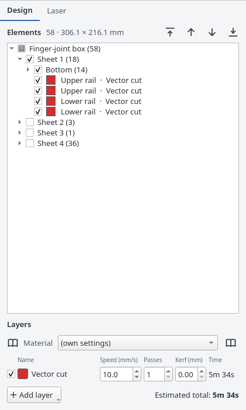

**Pattern fills.** The **Fill with a pattern**
tool (the bucket, Shift+F) fills closed shapes with engraved lines in a
pattern: lines, cross-hatch, waves, zigzag, circles, honeycomb, diamonds,
bricks, concentric (rings following the outline inwards), triangles,
herringbone, fish scales, square waves, spiral, sunburst, dots, crosses,
Truchet tiles or a Hilbert curve.

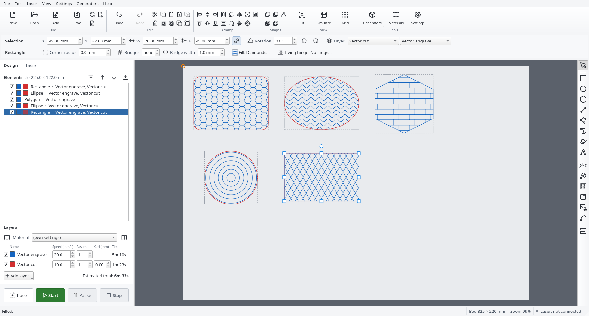

1. Choose the tool and click a closed shape on a cut or outline layer (or
   choose the tool with shapes selected: they all get the pattern). The
   **Fill** window opens.
2. Click a pattern among the tiles; set its **spacing** (the distance between
   its lines), its **angle** and a **margin** kept free inside the outline.
   The preview follows. **Fill it**.
3. The outline stays on its layer: a cut shape is still cut, and the pattern
   is engraved on an outline layer (for a cut shape a second **Layer** list
   chooses which). Untick **Outline** to engrave only the pattern: **Lines**
   or **Cross-hatch** without the outline fill an area with engraved lines
   (this was the separate Hatch section before 0.17; older projects open this
   way).

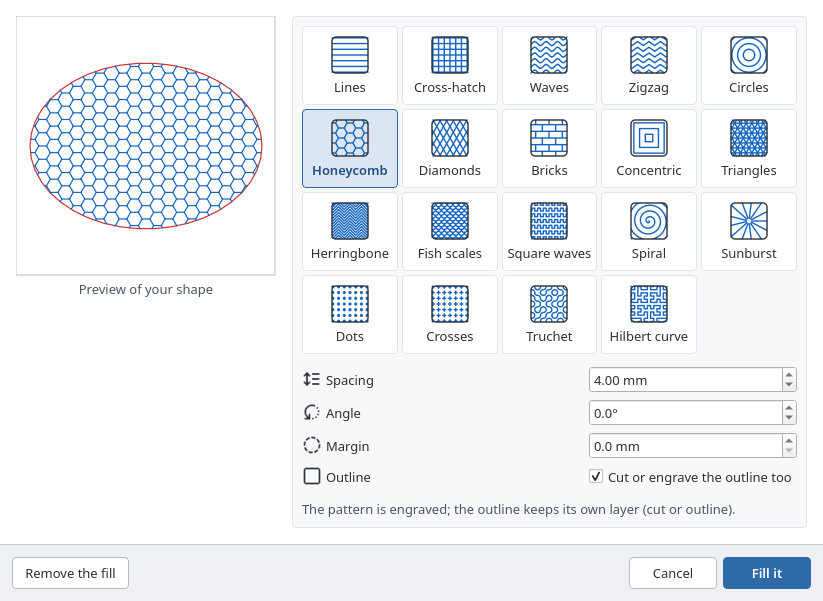

A selected shape has a **Fill** button in the options bar: it opens the same
window, where **Remove the fill** takes the pattern off. Holes in the shape
(for example in letters) stay empty. An opened SVG or DXF file must be
ungrouped first (Edit → Ungroup), so that its lines become shapes.

**Text on a path.** Choose the **Text on a
path** tool (Shift+T, the arc with letters on the right), then click a line,
curve or shape: the text is put on it, every letter standing on the line and
turned along it, and the **Text on a path** window opens with a preview: the
text, its font and size, its **Start** (the position along the path),
**From line** (the distance from the line; below zero the letters cross the
line) and **Other side**; **Straight text** takes it off the path, Cancel
leaves everything as it was. On an open line the text is centred, on a
closed shape it is centred at the top. If a text is selected when you click,
that text is moved onto the shape, so no copy stays behind.
**Drag the text to slide it along the line**; on a circle it goes round.
Double-click it (or **Edit text…** in the options bar) to change it again;
**Letter spacing** adds space between the letters, also for ordinary text. The shape
stays; delete it if it should not be cut. An existing text is put on a shape
with **Edit → Put text on path** (select both). The arrow keys and the X/Y
fields move the text together with its path.

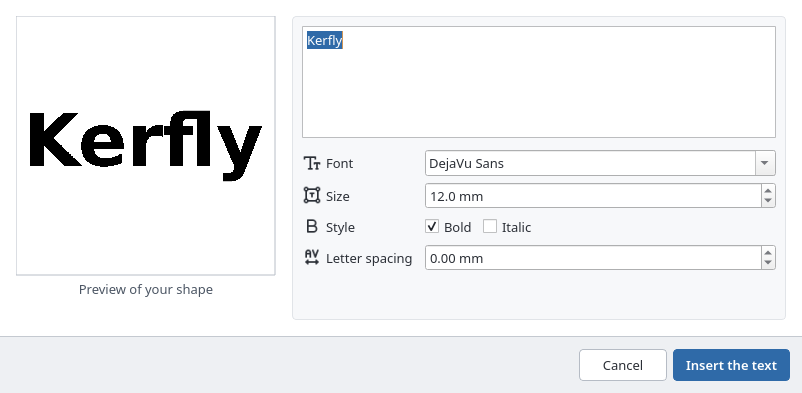

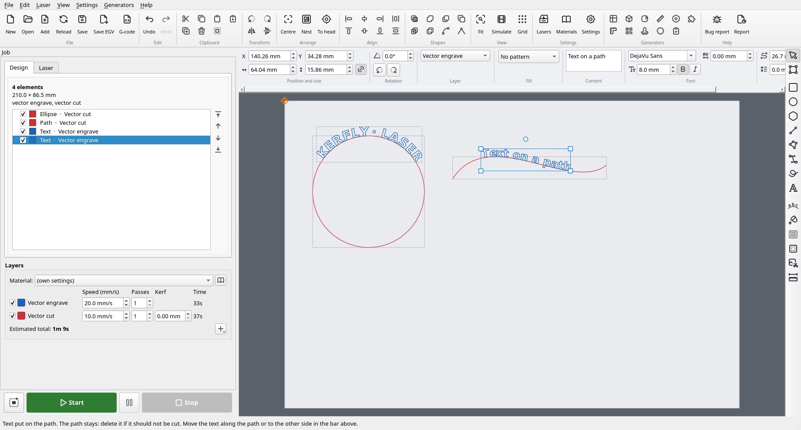

**Living hinges.** A living hinge is a field of
cuts that lets a sheet of plywood or MDF bend, for example round the corners
of a box. Choose the **Living hinge** tool (Shift+H, the sheet with cuts) and
click a closed shape (or choose it with shapes selected): the **Living
hinge** window opens, with straight, wavy and zigzag cuts as tiles and a
preview counting the cuts; **Cut the hinge** cuts them inside the shape,
before its outline. Its fields, each with an icon, a caption and a tooltip, set the length
of one cut, the **bridge** of uncut material between two cuts, the distance
between the rows (smaller bends more), the direction of the cuts (90°: up and
down, the sheet bends across them), the **margin** of solid material at the
ends of the hinge (across the rows; 0 by default), and the **band**: its width (0: the whole shape) and where its
middle is, measured from the middle of the shape (minus: left / up, plus:
right / down), for a hinge only where the sheet bends. The rows take turns:
one has only long cuts with a bridge at both ends, the next a short cut from
the outline at each end and long ones between; the cuts reach the outline, as
a solid border along it would keep the sheet from bending. A selected shape
has a **Living hinge** button in the options bar that opens the window again,
where **Remove the hinge** takes it off. Try a small piece first: how far
the sheet bends depends on the material.

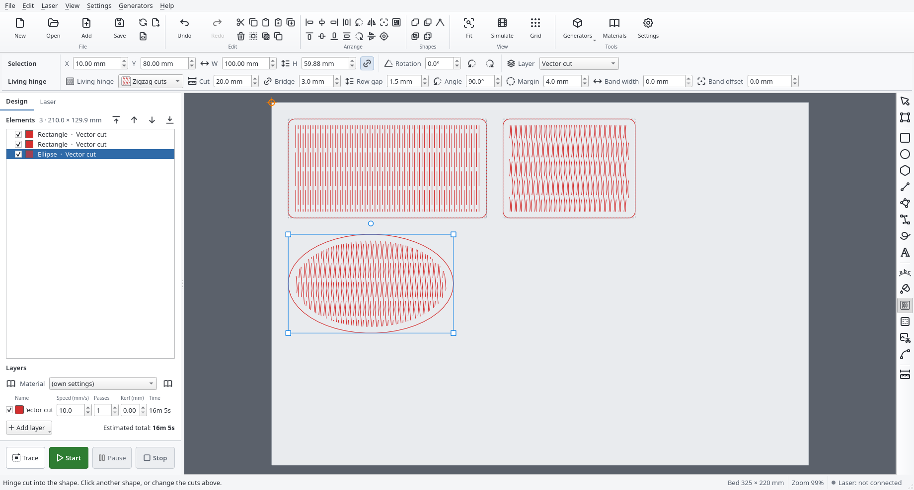

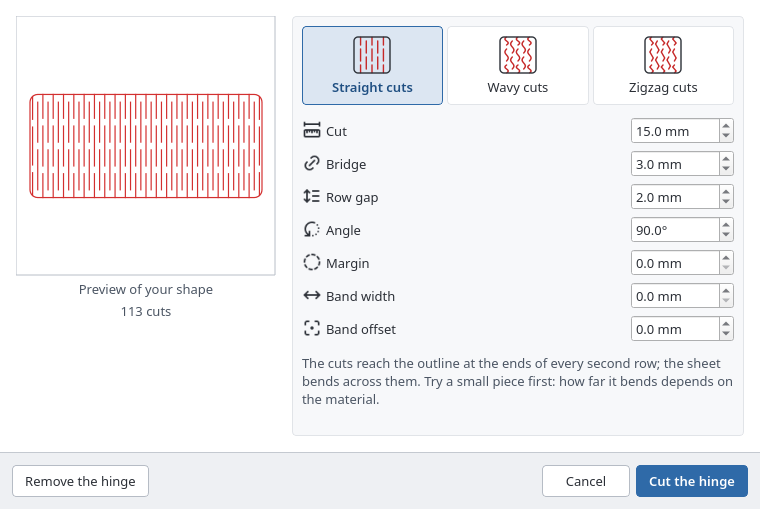

**Bridges (tabs).** A closed shape on a cut layer can keep small uncut
bridges that hold the part in the sheet: set their number (**Bridges**) and
**Bridge width** in the options bar.

**Element list.** The **Elements** of the **Design** tab list all elements with the colours of
their layers. Click a row to select it on the bed (Ctrl / Shift: several);
untick it to leave it out of the job. An opened file is listed with its
folder (**Customer A › design.svg**), so files of the same name from different
folders can be told apart, and the bottom bar shows the folders and file of
the design under the mouse pointer (or of the selected one); the whole path
is in its tooltip. Saved projects keep where each file came from.

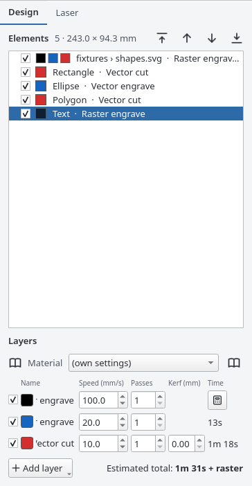

**Generators.** The **Generators** button of the ribbon (and the
**Generators** menu), in three parts (boxes, parts, tests and calibration),
makes ready designs from a few numbers. Each one opens a window with its
settings on the left (a **beta** mark on what is not yet confirmed on a laser)
and a preview on the right, its size and number of shapes under it; Enter in a field updates the
preview, **Insert** puts the design on the bed at the laser head as one
group (drag it into place; one **Undo** takes it away). The last numbers are
remembered.

- **Material test**: a grid of fields, each with its own speed (columns) and
  power or number of passes (rows), each field on a layer of its own, the
  values engraved beside them. Cut or engrave it, then pick the best field.
  Power changes only on M3 boards; on other boards the rows change the passes.
- **Finger-joint box**: bottom, four walls and a lid (or an open box) that fit
  together with fingers; outside or inside sizes, material thickness, finger
  width and the kerf (the parts grow by half of it so the fingers fit
  tightly). The parts are laid out to fit the bed; those that do not fit go
  on a next sheet (**Sheet 2**, …), at the same place, on the same cut layer.
  In the element list the box is one group with a group for each sheet (and
  each part made of several shapes, an outline and its slots, is a group of
  its own); sheets 2 and on start unticked: cut sheet 1, change the material,
  untick sheet 1 and tick the next one. **Each part on its own layer** puts
  every part on a cut layer of its own. **Dividers across
  / along** (beta, not yet checked on a laser) add inner walls, evenly spaced:
  their tabs go through slots in the walls and the bottom, crossing dividers
  are joined by slots to half their height. **Sliding lid** (beta) slides in
  from the front, in a groove between two level rails on each side wall; the
  rails' tabs go into slots of the wall, and a strip of the wall at least 3 mm
  high stays above the upper rail, for strength. The front is lower, so the
  lid slides over it. The
  parts are laid out to use the bed well: turned where that helps, into the
  room left on earlier sheets.
- **Rounded box with a living hinge** (beta, not yet checked on a laser): a
  bottom and a lid with rounded corners, the wall two equal strips that bend
  round the corners with a living hinge; the tabs of the bottom and the lid
  hold it together; without a lid a rim round the top holds the wall in shape.
  Width, depth, height, corner radius, material, tab width, kerf and the
  hinge's cut length, bridge and row spacing.

For both boxes the preview has a **3D** switch beside **Parts**: the box put
together from the very parts that will be cut (fingers, slots, rails,
dividers). Drag to turn it, the mouse wheel zooms, a double click turns it
back. **Pulled apart** moves the parts away from each other, to see how their
fingers and tabs go together; **Hidden edges** shows the edges behind other
parts dashed, as in a technical drawing; with a sliding lid, the **Slide the
lid out** slider pulls the lid out of its groove. These switches are beside
**Parts | 3D**, over the preview.

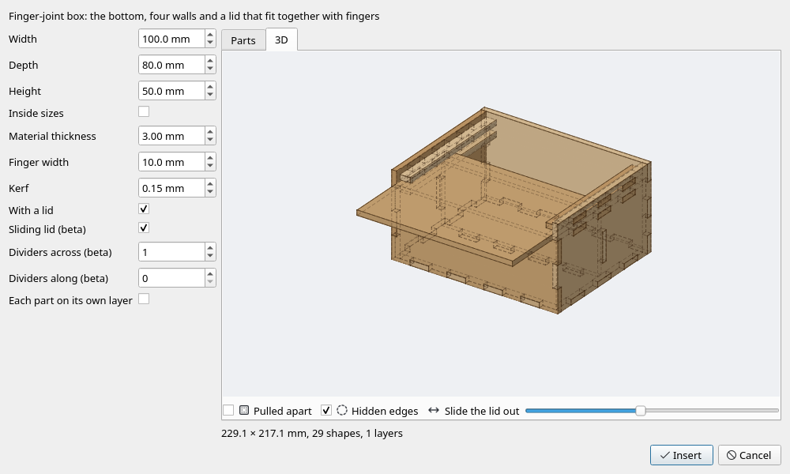
- **Kerf test**: a comb cut into pieces (push them together and measure:
  kerf = (length − measured) / pieces) and a plate with slots of the
  material's thickness plus a clearance each, to find the tightest fit.
- **Gear**: a spur gear with involute teeth (teeth, module, pressure angle)
  and a hole for the axle.
- **Puzzle**: a jigsaw puzzle cut of any size and number of pieces, with
  round tabs; **Variant** turns the tabs other ways.
- **Ruler**: a mark every millimetre, numbers every centimetre.
- **QR code**: a text or web address as a code to engrave (raster).
- **Stamp**: a rubber stamp. Choose the size (usual self-inking sizes or your
  own), type the text in the small editor above the preview (select a part
  and press **B** bold, **I** italic, **U** underline, **A+ / A−** bigger or
  smaller, or align the lines: for example the name big and bold, the address
  smaller), choose the font, a picture (logo) and a frame, then
  **Generate stamp**: the colours are inverted (the background is burnt away,
  the text stays raised) and the stamp is mirrored, so it prints the right
  way round. A cut line around it cuts the stamp out of the rubber.
- **Round stamp**: the same for a round stamp: a diameter (usual sizes or
  your own), text around the top and the bottom with a dot on each side, an
  outer and an inner ring, and text lines or a picture in the middle. Both
  ring texts get the same letter height, as large as fits.
- **Test card**: every operation on a piece of 3 mm plywood (a 50 mm square
  with a 20 mm hole, a 100 mm ruler, raster, patterns, a hinge, text on a
  path, bridges), to check the laser.

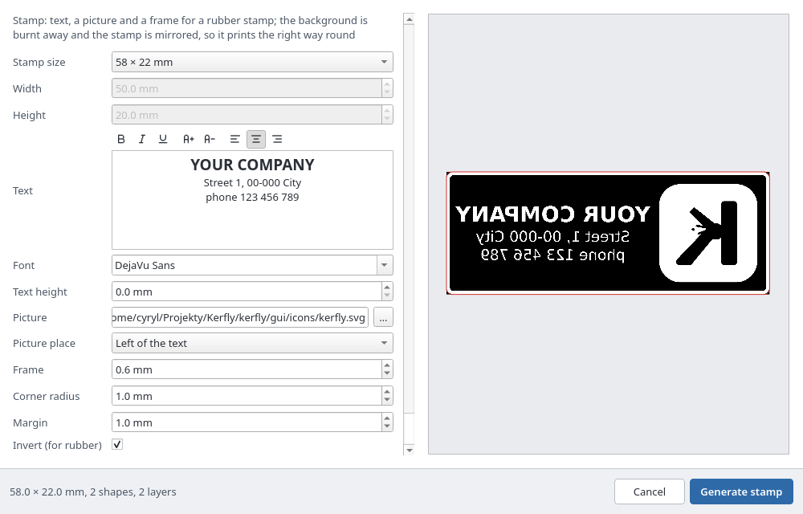

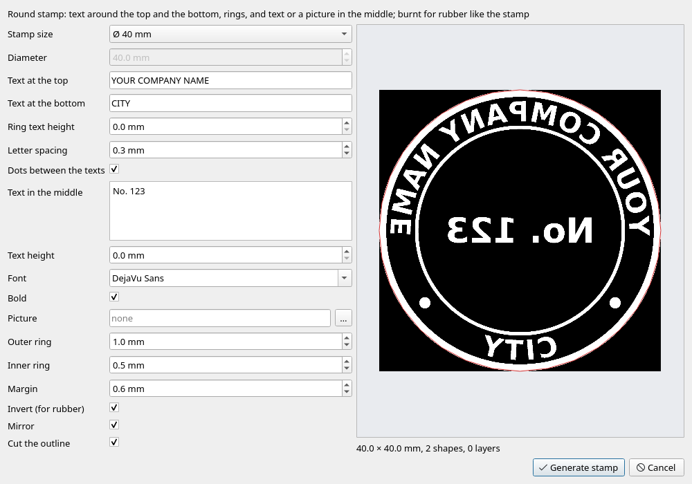

## 6. Layers and materials

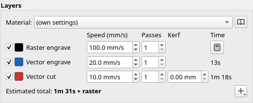

Every element has up to three parts: a **raster engrave** part (pictures and
fills), a **vector engrave** (outline) part and a **vector cut** part. Each
part goes to a **layer**. A layer has its own speed, number of passes,
power (M3 boards with power control) and colour. Untick a layer to leave it
out of the job.

- **The layer decides what the laser does.** Select a drawn shape and choose
  its layer in the **Layer** list of the options bar: a cut layer cuts it, an
  outline layer engraves its outline (and its pattern fill), a raster layer fills it.
- **More layers.** **Add layer** under the layers adds another cut,
  outline or raster layer, for example a second cut layer with another speed.
  Layers run in the order raster, outline, cut.
- **Kerf.** The laser burns away a thin line, so a part cut along its
  outline comes out a little smaller and its holes a little larger. Type the
  width of the cut into the **Kerf (mm)** column of a cut layer (measure it with
  **Generators → Kerf test**): the outlines are cut half of it further out and
  the holes half of it further in, so the parts come out at their drawn size.
  Open lines are cut as drawn. 0 switches it off. The material library keeps
  a kerf for each material too.
- **Time.** The **Time** column shows how long each layer takes; for raster
  layers press the calculator button; the total is under the table (the units
  of the columns are in their headers). **View → Simulate job…**
  (Ctrl+Shift+J, **Simulate** on the ribbon) opens a window of its own that
  plays the head's moves: the whole job is grey, what the laser has burnt so
  far turns red (an engraved picture only where it is dark), moves with the
  laser off are grey dashed lines. Over it **Play** / **Pause**, the slider,
  the time, the **Speed** (5× at first, faster for a long job) and **Next layer**; under it the layer being
  lasered. Keep it open while you work: when the design changes, it works the
  job out again after a moment and stays at its place in time (paused; a note
  says so). New and Open close it.
- **Materials.** **Settings → Material library…** (the book button next to the
  material list, **Materials** on the ribbon) stores, per material (for
  example "Plywood 3 mm"), its thickness, a table of speeds, passes, powers and
  kerf, and notes. Choosing a material in
  the **Material** list above the layers sets all layers at once.
  **New from current layers** saves every layer of the job: besides the three
  basic ones, extra layers (a second cut, another engraving…) are kept under
  **Other layers** by their names, and applying the material sets them again
  or adds them. The library can be exported and imported to share it. **Each
  laser has a library of its own**; lasers of the same kind can use one:
  Settings → Lasers…, **Material library** (a copy made with Duplicate shares
  the original's at first). A laser that starts sharing brings its own
  materials into the shared library (names it already has stay as they are).

## 7. Running a job

1. Connect and home the laser, put the material in and focus.
2. Place the design on the bed (or let it follow the head, see section 3).
3. **Trace boundary** (the dashed-outline button, Laser menu) drives the head
   around the design, with the laser off unless set in the settings, so you
   can check where it will be cut. It runs round the rectangle around the
   design, starting at the corner nearest the head (Settings → Lasers…, Boundary
   trace: switch off "Boundary trace as a rectangle" to follow the outline
   instead).
4. **Start** (F9) runs all ticked layers. **Pause** stops the laser for a
   moment and the same button resumes it. **Stop** (Esc) ends the job
   immediately; then press **Home** before the next job. These buttons stay
   at the bottom of the left panel, also when it scrolls on a small screen.
   The mouse wheel changes a number field or a list only after you click
   into it, so scrolling the panel cannot change a speed by accident.
   To run one kind of work at a time (for example engrave first, check it,
   then cut), switch on **Engrave, Outline and Cut buttons next to Start** in
   Settings → View: **Engrave only**, **Outline only** and **Cut only** run all
   the ticked layers of that kind, each with its own settings (also in the
   Laser menu). Their tooltips show how long their part takes.
5. The progress bar at the bottom shows the percentage of the current step
   (preparing the data, sending it to the laser).

**Safety check.** Before anything is sent, Kerfly checks that the head stays
on the bed during the whole job and the trace. If it would leave the bed by
more than 1 mm, nothing is sent and the status bar says which edge and by how
much.

**Test fire** (M3 boards, Laser tab): fires the laser briefly with the power
and time set next to the button.

**EGV files.** **File → Save EGV file…** writes the job to a file (not with
M3 power per operation); **File → Send EGV file to laser…** sends an existing
EGV file.

**G-code for GRBL lasers.** **File → Save G-code…** (Ctrl+Shift+K,
**G-code** in the File group of the ribbon) writes the job as G-code for a
laser with a GRBL board (diode lasers, CO2 lasers with GRBL), to run with
LaserGRBL, UGS or another sender: the ticked layers in their order (raster,
engrave, cut), each with its speed (F, mm/min), power (S) and passes, in
laser mode M4. Before the file name it asks for the **origin** (X0 Y0 at the
bed's lower left corner, as most GRBL lasers home, or at the design's upper
left corner, where you set the work origin on the machine), **full power S**
(the machine's `$30`, 1000 on most boards; a layer's power is that part of
it) and the **raster overscan** (the head starts and stops this far beyond
each raster line, so it is at speed where it burns). These are kept with the
laser profile.

**A GRBL laser connected to Kerfly.** In **Settings → Lasers…** choose
**Machine: GRBL board, serial port**, then its **serial port** (or the first
board that answers; ↻ looks again after plugging it in), its speed (115200
on most boards), the **home corner** (in the Work area section: a picture of
the bed, click the corner; lower left on most GRBL lasers), the **jog speed**,
**full power S** (`$30`) and **air assist** (tick it when the air pump or
valve is wired to the board's coolant output: `M8` at the start of a job,
`M9` at its end; also in a saved G-code file). These are kept in the
laser profile, so a K40 and a GRBL laser can each have their own; a laser's
settings show only what its machine has (no K40 board, USB or power settings
for a GRBL laser, no GRBL fields for a K40), and the window hides the K40's
test fire and EGV files for a GRBL laser. With a GRBL
machine speeds are shown and typed in **mm/min**, as GRBL lasers are used
(the K40 stays in mm/s). Then the
usual buttons work on it: **Connect** opens the port and reads the board's
settings (and homes with `$H` when homing is on and Home when initializing
is ticked; without limit switches put the head in the home corner before
switching the board on), **Home** `$H`, **Unlock** `$X`, the **arrows** and
the corner buttons jog the head, **Trace boundary** drives round the design,
**Start** moves the head to the design's upper left corner, makes that X0 Y0
(`G92`) and streams the job's G-code, **Pause** holds the machine (`!`) and
resumes it (`~`), **Stop** resets it (then Unlock or Home). The board should
be in laser mode (`$32=1`); Kerfly says so when it is not. On Linux the
serial port needs your user in the `dialout` group:
`sudo usermod -aG dialout $USER`, then log out and in again.

## 8. Settings

**Settings → Settings…** (Ctrl+,, **Settings** on the ribbon) has the
program's settings, the same for every laser, in four categories in a list on
the left; each page is in sections. **Save** keeps the changes, **Cancel**
leaves them.

| Category | Settings |
|---|---|
| Raster | halftone (dither), its method (Floyd-Steinberg, Atkinson for more contrast on wood, Jarvis, Stucki, Burkes and Sierra for smoother gradients, ordered Bayer for an even texture, threshold) and its resolution, invert colours, mirror, rotate 90°, engrave bottom to top, scan line step, levels curve |
| Vector | cut inside shapes first |
| View | units (mm or inches), snap grid size (0: off), snap to other objects, the design follows the laser head (these three are also remembered by themselves when changed in the View menu), Engrave / Outline / Cut buttons next to Start, theme: light, dark or as the system (after a restart) |
| Advanced | language (after a restart), checking for new versions, Inkscape, reduced memory use |

**Settings → Lasers…** has each laser's own settings, in sections:

| Section | Settings |
|---|---|
| Controller | the machine (K40 or a GRBL board), controller board, USB port; for a GRBL board its serial port, speed and full power S |
| Head movement (GRBL) | the jog speed of the arrows and the corner buttons (the homing speed is the board's own, `$25`); a K40's board moves and homes at its own speed |
| Work area, homing and the end of a job | bed size, the **home corner** (a picture of the bed with a radio button in each corner: the one the head homes to; Place design at the head and Design follows the head bring the design's same corner to the head), home when connecting, home the head after a job (back to 0, 0, for the next piece), unlock the rail and beep after a job, a report after a job (its time, on by default; a small window that waits until you are back) |
| Programs run with a job | a program run before every job sent to the laser (for example to switch on the exhaust; the job waits until it ends, at most a minute, and asks when it fails), a program run after every finished job (for example to switch off the exhaust or send a message; its output and errors go to the report) |
| Scale, power | X/Y scale factors, M3 power per operation and maximum power (greyed out with other boards: their power is set with the knob of the laser; a GRBL laser always has a power for each layer) |
| Moves between cuts (K40, beta) | short moves without stopping, up to (mm): a K40 makes each move between two cuts as a fast move, stopping and leaving the cutting mode (the head seems to jump off at every bridge of a living hinge); moves up to this long are made at the cutting speed with the laser off, without stopping (a hinge or a fill takes less time). 0: as before |
| Material library | its own, or shared with another laser of the same kind |
| Boundary trace | with the laser on and its power (in per cent of the maximum; M3 board), as a rectangle or along the outline, trace gap and speed |
| Rotary attachment | the attachment, its scale factor and rapid speed (greyed out while it is off) |
| USB connection | USB data preparation, waiting for the laser, USB timeout and retries |

Kerfly is available in English, Polish, German, Spanish and French.

**New versions.** Once a day at start Kerfly asks GitHub, where it is
published, whether a new version is out (nothing about you or your work is
sent). When there is one, a bar above the bed says so: **See the release**
opens its page with what is new and the files to download, **Later** hides
the bar, **Skip this version** stops reminding about it. **Help → Check for
updates** asks at once. Don't want it? Untick it in
Settings → Advanced. Kerfly never downloads or installs anything by itself.

## 9. Keyboard shortcuts

**Help → Keyboard shortcuts** (Ctrl+F1) shows all of them in a window, with
the mouse actions and a search field.

| Keys | Action |
|---|---|
| Ctrl+N | New project |
| Ctrl+O / Ctrl+Shift+O | Open design / add design |
| F5 | Reload design |
| Ctrl+S / Ctrl+Shift+S | Save project / save project as |
| Ctrl+Shift+E | Save EGV file |
| Ctrl+Shift+K | Save G-code (GRBL) |
| Ctrl+Z / Ctrl+Shift+Z | Undo / redo |
| Ctrl+D / Del | Duplicate / delete |
| Ctrl+C / Ctrl+X / Ctrl+V | Copy / cut / paste (at the mouse pointer when it is over the bed) |
| Ctrl+Alt+V | Paste in place (where the elements were) |
| Ctrl+A / Esc (on the bed) | Select all / select nothing |
| Ctrl+L / Ctrl+R, also Ctrl+[ / Ctrl+] | Rotate 90° left / right |
| Ctrl+Shift+H / Ctrl+Shift+V, also H / V on the bed | Mirror horizontally / vertically |
| Ctrl+G / Ctrl+Shift+G | Group / ungroup |
| Ctrl+J | Join into a polyline |
| Ctrl+Shift+N | Nest on the bed |
| Ctrl++ / Ctrl+- / Ctrl+* / Ctrl+^ | Union / difference / intersection / exclusion |
| Ctrl+E | Centre on the bed |
| PgUp / PgDown | Move up (earlier) / down (later) in the element list (Ctrl: to the start / end) |
| Ctrl+H | Place design at the head |
| Ctrl+Alt+H | Design follows the head (on / off) |
| Arrow keys (Shift: ×10) | Move the selected element |
| Ctrl+arrow keys | Move the laser head by one step |
| Ctrl+7, 9, 5, 1, 3 | Head to the design's upper left, upper right, centre, lower left, lower right |
| Ctrl+Alt+G | Go to the X/Y position |
| Ctrl+I | Connect to the laser |
| Home | Home the head |
| F9 / Esc | Start / stop |
| Ctrl+0 | Fit the bed to the window |
| Ctrl+Shift+J | Simulate the job |
| Ctrl+' / Ctrl+; | Snap to grid / snap to objects |
| Alt (held) | Snap to nothing for a moment |
| Ctrl+, | Settings |
| F1 | This user guide |
| Ctrl+F1 | All keyboard shortcuts in one window |
| S, N, R, E, P, L, Shift+L, B, F, T, Shift+T, Shift+F, Shift+H, Shift+O, M | Tools (see section 5) |

## 10. When something goes wrong

**Help → User guide** (F1) opens this guide.

- **Help → Report a problem on GitHub…** (also in **Help → About Kerfly**) saves a
  diagnostic report and opens the report form with your version, system and
  board filled in. Drag the report file into the form's *Diagnostic report*
  field. You can write in English or Polish. A free GitHub account is needed.
- **Help → Save diagnostic report…** only saves the
  report: settings, self-test and the log of everything sent to the laser.
- **Help → Open the log folder** shows `kerfly.log`.

Common problems:

| Problem | What to do |
|---|---|
| "Laser is not initialized" | Press the plug button on the Laser tab (Ctrl+I). On Linux choose **Laser → Allow USB access for the laser…**; on Windows check the libusb driver |
| The head is not where the program shows it | Press Home. This happens after Unlock rail, after moving the head by hand and after Stop |
| An element is drawn red, Start does not work | The element sticks out of the bed: move it back |
| SVG text is missing or not cut | Install Inkscape: it turns SVG text into paths |
| The laser stops responding | **Laser → Unfreeze laser**, then **Release USB** and connect again |
