# Kerfly user guide

Kerfly controls K40-class CO2 lasers with Lihuiyu (M2 Nano family) boards:
it places your designs on the laser bed, lets you draw and edit them, and
sends the job to the laser. This guide is for version 1.4.

> Always keep a hand near the laser's power switch, and never leave a
> running laser unattended.

- [1. First start](#s1)
- [2. The window](#s2)
- [3. Moving the laser head](#s3)
- [4. Opening files](#s4)
- [5. Drawing and editing](#s5)
- [6. Layers and materials](#s6)
- [7. Running a job](#s7)
- [8. Settings](#s8)
- [9. Keyboard shortcuts](#s9)
- [10. When something goes wrong](#s10)

## 1. First start

1. Install Kerfly as described in the
   [installation guide](https://github.com/cyryllo/Kerfly/blob/main/INSTALL.md),
   from the [releases page](https://github.com/cyryllo/Kerfly/releases):
   - **Windows 10 / 11:** run `Kerfly-<version>-windows-setup.exe`. The
     installer is not signed, so Windows may say "Windows protected your PC":
     choose **More info → Run anyway**. The first time, tick the USB driver
     for the K40 laser.
   - **Linux:** make `Kerfly-<version>-x86_64.AppImage` executable and run
     it. Allow the laser's USB port once: **Laser → Allow USB access for the
     laser…** (asks for your password), then plug the laser in again.
   - **macOS** (preview): open the `.dmg` and drag Kerfly to Applications;
     the first start goes through **System Settings → Privacy & Security →
     Open Anyway** (the installation guide shows it). USB needs no driver.
2. Check the installation with the self-test (in a command window /
   terminal):
   - Windows installer: `"C:\Program Files\Kerfly\kerfly-console.exe" --self-test`
   - AppImage: `./Kerfly-<version>-x86_64.AppImage --self-test`
   - macOS: `/Applications/Kerfly.app/Contents/MacOS/Kerfly --self-test`

   Every line should say `OK`; `WARN` lines are optional parts or mean that
   the laser is not connected.
3. Open **Settings → Settings… → Machine** and choose your **Controller
   board** (printed on the board, for example LASER-M2 or LASER-M3), the
   **units** and the **bed size**.
4. Switch the laser on, connect the USB cable and press the **plug** button
   (Connect, Ctrl+I) on the **Laser** tab. By default Kerfly then homes the
   head (moves it to the upper left corner).

Kerfly keeps its settings in `k40_whisperer.txt` in your home folder.
**File → Save settings as default** keeps changed settings. The language,
the grid, snapping and "design follows the head" are kept at once, without
saving.

## 2. The window

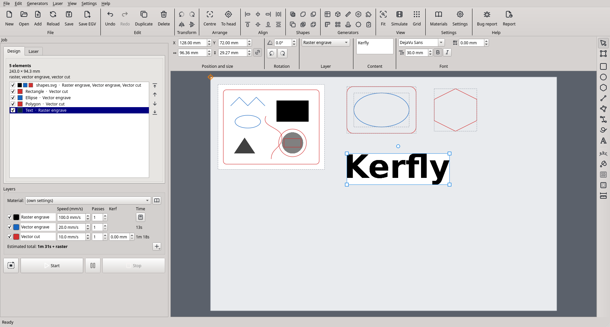

- **Toolbar** (top): file, edit, arrange, generators, view, settings and help
  commands in labelled groups.

  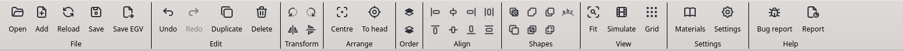

- **Options bar** (under the toolbar): position, size and rotation of the
  selected element, its layer, and the options of the selected shape or
  drawing tool (for example the text and font). When its sections do not fit
  the window, they scroll sideways.

  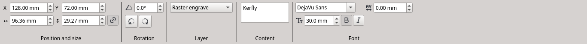

- **Left panel**: the **Design** tab lists the elements on the bed; the
  **Laser** tab moves the head. Under the tabs are the **Layers** and the job
  buttons (trace, start, pause, stop).
- **Bed view** (middle): the laser bed with your elements. The orange
  crosshair is the laser head. Elements that stick out of the bed are drawn
  red, and the job cannot start until they are moved back.
- **Tools** (right), in three groups: selecting (select, edit nodes); drawing
  (rectangle, ellipse, polygon, line, polyline, pen, freehand, text); and
  operations on shapes (text on a path, fill with a pattern, living hinge,
  measure).

Mouse in the bed view: the wheel zooms in and out (not further than the
whole bed); the middle or right button drags the view; **Ctrl+0** fits the
bed to the window. A **right click** (without dragging) opens a menu: on an
element its commands (copy, cut, paste, duplicate, delete, group, **Layer** ▸
to move all selected elements to another layer at once, combine shapes,
offset, order, align, turn, mirror, fill, edit nodes, centre, leave out of
the job); on the empty bed **Move the head here** (laser connected), paste,
select all, fit, grid.

## 3. Moving the laser head

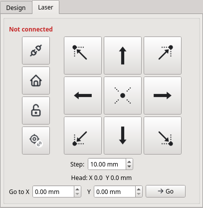

The **Laser** tab has the machine buttons on the left and the jog pad on the
right.

| Button | What it does |
|---|---|
| Plug | Connect to the laser (Ctrl+I) |
| House | **Home**: move the head to the home corner |
| Open lock | **Unlock rail**: release the motors so the head can be moved by hand |
| Crosshair with a chain link | **Design follows the head** (Ctrl+Alt+H), see below |
| Arrows | Move the head by one **Step** (the field under the pad). **Ctrl+arrow keys** do the same from the keyboard |
| Dotted corners and centre | Move the head to that corner or the centre of the design, to see where it will be cut. The design does not move. Ctrl+7, Ctrl+9, Ctrl+5, Ctrl+1, Ctrl+3 |
| Go to X / Y, **Go** | Home, then move the head to that position (distance from the home corner; Ctrl+Alt+G) |

The plain arrow keys (without Ctrl) move the **selected element** on the bed,
not the head.

**Where the job starts.** The design stays where it is on the bed (as in
LightBurn or MeerK40t): when a job starts, the head first drives to the
design. To start the design where the head is instead:

- **Edit → Place design at the head** (Ctrl+H, toolbar **To head**) moves the
  design to the head once.
- **Design follows the head** (the button with the chain link, green when
  on) keeps the design at the head: the arrows, Go to X/Y and Home move the
  head and the design together, and the arrows do not push the design off
  the bed. The corner buttons still only move the head.

The K40 does not report where its head is. Kerfly counts the moves it sends;
after the motors were unlocked, the head was moved by hand, or a job was
stopped, press **Home** before the next job. After a stopped job Kerfly says
so in the status bar.

## 4. Opening files

**File → New project** (Ctrl+N, toolbar **New**) starts with an empty bed
and the default layers (it asks to save unsaved changes first).
**File → Open design…** (Ctrl+O) replaces everything on the bed;
**File → Add design…** (Ctrl+Shift+O) puts another file next to the others.

| File | What becomes of it |
|---|---|
| SVG | Red lines are cut, blue lines engraved as outlines, everything else (fills, pictures, black lines) is raster engraved. Inkscape is used when installed, otherwise the built-in renderer; Inkscape is needed for SVG text that is cut or engraved as an outline |
| DXF | Cut lines; blue entities and layers named *engrave* become outline engraving |
| PNG, JPG, BMP, TIFF, GIF, WebP | Raster engraving: dark pixels are engraved. Kerfly shows the image size; set the resolution or the width and height |
| G-code (.ngc, .gcode, .nc, .g, .tap) | Run as G-code |
| Kerfly project (.kerfly) | The whole layout, layers and drawn shapes |

**File → Save project** (Ctrl+S) saves the layout, the layers, the drawn
shapes and copies of the opened files in one `.kerfly` file, so it can be
moved to the computer at the laser. **Reload design** (F5) reads the opened
files again after you changed them in another program.

## 5. Drawing and editing

Choose a tool on the right (or press its key), then draw on the bed with the
mouse. The options of the tool are in the options bar; you can change them
before or after drawing.

| Tool | Key | How |
|---|---|---|
| Select and move | S | Click to select, drag to move; handles scale and rotate. Drag a frame around several elements, or Ctrl+click |
| Edit nodes | N | Drag nodes and the round curve handles (Ctrl: one handle alone). Double-click a side to add a node, a node to remove it. Keys: I insert, D delete, L line, C curve, O smooth, S symmetric, Z close / open, B break |
| Rectangle | R | Drag. Shift: square. Option: corner radius |
| Ellipse | E | Drag. Shift: circle |
| Polygon | P | Drag. Option: number of sides |
| Line | L | Drag. Shift: steps of 45° |
| Polyline | Shift+L | Click the corners. Click the first point to close; double-click or Enter for an open line; Backspace removes the last corner; Esc cancels |
| Pen (curves) | B | Click for a corner, press and drag for a smooth curve. Click the first point to close; double-click or Enter to finish |
| Freehand | F | Draw with the button held; end near the start to close the shape |
| Measure | M | Drag between two points: distance, width, height and angle |
| Text | T | Click, then type in the **Content** field; choose the font, size, bold and italic |
| Text on a path | Shift+T | Type the text in the options bar, then click a line, curve or shape (see below) |
| Fill with a pattern | Shift+F | Choose a pattern in the options bar, then click closed shapes to fill them (see below) |
| Living hinge | Shift+H | Choose the cuts in the options bar, then click closed shapes to cut a hinge into them (see below) |
| Offset | Shift+O | Set the distance in the options bar, then click closed shapes to draw a new outline around them (see below) |

**Snapping.** Drawing and moving snap to the corners, centres and edges of
other elements and to the bed (**View → Snap to objects**, Ctrl+;), and to
the grid when it is on (**View → Snap to grid**, Ctrl+'; **View → Grid
size**). Hold **Alt** to snap to nothing for a moment. Kerfly remembers the
grid (on or off, and its size), snapping to objects and **Design follows the
head** by itself for the next start; they can also be set in **Settings →
View**.

**Moving precisely.** Type the position, size and angle in the options bar
(the chain button keeps the proportions), or use the arrow keys: 1 mm or one
grid step, with Shift 10 times as far.

**Arranging.** The **Edit** menu and the toolbar have: undo and redo
(Ctrl+Z, Ctrl+Shift+Z), copy, cut and paste (Ctrl+C, Ctrl+X, Ctrl+V: pasted at
the mouse pointer, also into another project; Ctrl+Alt+V pastes in place),
select all (Ctrl+A), duplicate (Ctrl+D), delete (Del), rotate 90°
(Ctrl+L, Ctrl+R), mirror (Ctrl+Shift+H, Ctrl+Shift+V), centre on the bed
(Ctrl+E), align and distribute, and **Combine shapes**: union, difference,
intersection and exclusion of closed shapes (difference: the other selected
shapes are cut out of the one highest in the element list).

**Offset.** The **Offset** tool (Shift+O, also Edit → Offset) draws a new
outline a set distance around a shape. In the options bar set the
**distance** (positive outside, holes get smaller; negative inside), round
or sharp **corners** and **Keep the original** (off: the new outline replaces
the shape), then click closed shapes on the bed. Shapes you selected before
choosing the tool get it with **Offset selected**. Use it for a border
around a text, a frame around a part, or a smaller copy inside.

**Order.** The element list is the order of the job: within each layer the
laser does the element at the top of the list first. (The layers themselves
always run in the order raster engraving, outline engraving, cutting.) Inside
one element, inner shapes are still cut before the outer ones, so a part
does not fall out before its holes are cut. The arrow buttons beside the
element list (Design tab) move the selected elements: **Move up (earlier)**
and **Move down (later)** one place (PgUp, PgDown while the bed view has the
focus), **To the start** and **To the end** to the top or the bottom of the
list (Ctrl+PgUp, Ctrl+PgDown).
Groups move together.

**Groups.** **Group** (Ctrl+G) makes several elements move together;
clicking one member selects the whole group, a second click selects that
member alone. **Ungroup** (Ctrl+Shift+G) splits a group, and also an opened
SVG or DXF file: each of its lines becomes a shape you can edit, and its
pictures split into their separate parts. Double-click any element to edit
its nodes.

**Pattern fills.** The **Fill with a pattern**
tool (the bucket, Shift+F) fills closed shapes with engraved lines in a
pattern: lines, cross-hatch, waves, zigzag, circles, honeycomb, diamonds,
bricks or concentric (rings following the outline inwards).

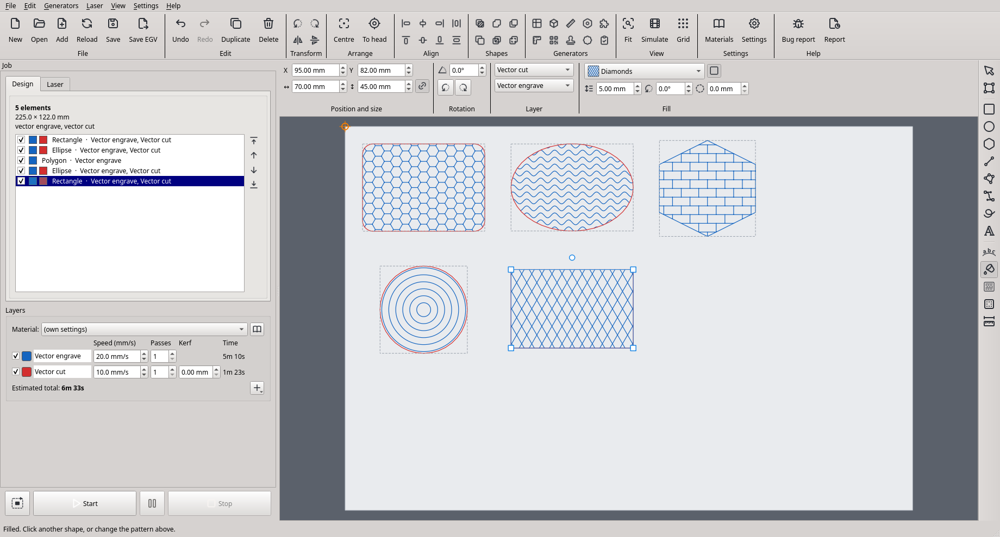

1. Choose the tool and a pattern in the **Fill** section of the options bar.
   Set its size (the distance between its lines), its angle and a margin
   kept free inside the outline.
2. Click a closed shape on a cut or outline layer. Click more shapes to fill
   them too; shapes that are selected get the pattern you choose at once.
   With shapes selected, the options bar shows what they have now (**No
   pattern** for shapes without one); the **Living hinge** tool works the
   same way.
3. The outline stays on its layer: a cut shape is still cut, and the pattern
   is engraved on an outline layer (for a cut shape a second **Layer** list
   chooses which). The square button next to the pattern list leaves the
   outline out, so only the pattern is engraved: **Lines** or
   **Cross-hatch** without the outline fill an area with engraved lines (this
   was the separate Hatch section before 0.17; older projects open this way).

A selected shape shows the same **Fill** section with the select tool: change
the pattern there, or choose **No pattern** to remove it. Holes in the shape
(for example in letters) stay empty. An opened SVG or DXF file must be
ungrouped first (Edit → Ungroup), so that its lines become shapes.

**Text on a path.** Choose the **Text on a
path** tool (Shift+T, the arc with letters on the right), type the text and
choose its font in the options bar, then click a line, curve or shape: the
text is put on it, every letter standing on the line and turned along it. On
an open line the text is centred, on a closed shape it is centred at the top.
If a text is selected when you click, that text is moved onto the shape (for
example one written with the Text tool), so no copy stays behind.
**Drag the text to slide it along the line**; on a circle it goes round. The
**Text on path** section of the options bar has the **position along the
path** (route icon), the **distance from the line** (line-height icon; below
zero the letters cross the line), the **other side** button and **Straight
text**; the **letter spacing** field (AV icon) of the **Font** section adds
space between the letters, also for ordinary text. Hold the mouse over a
field to see what it does. The shape
stays; delete it if it should not be cut. An existing text is put on a shape
with **Edit → Put text on path** (select both). The arrow keys and the X/Y
fields move the text together with its path.

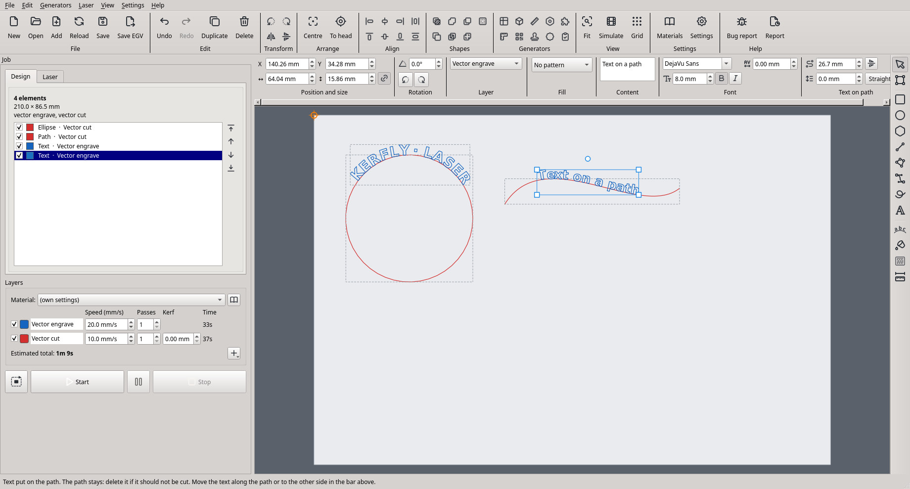

**Living hinges.** A living hinge is a field of
cuts that lets a sheet of plywood or MDF bend, for example round the corners
of a box. Choose the **Living hinge** tool (Shift+H, the sheet with cuts),
choose the cuts in the options bar (straight, wavy or zigzag), then click a
closed shape: the cuts are cut inside it, before its outline. The fields of
the **Living hinge** section, each with an icon and a tooltip, set the length
of one cut, the **bridge** of uncut material between two cuts, the distance
between the rows (smaller bends more), the direction of the cuts (90°: up and
down, the sheet bends across them), the **solid border** kept along the
outline, and the **band**: its width (0: the whole shape) and where its
middle is, measured from the middle of the shape (minus: left / up, plus:
right / down), for a hinge only where the sheet bends. Selected shapes get the hinge you choose at once; a shape with a
hinge shows the section with the select tool too, where **No hinge** removes
it. Try a small piece first: how far the sheet bends depends on the material.

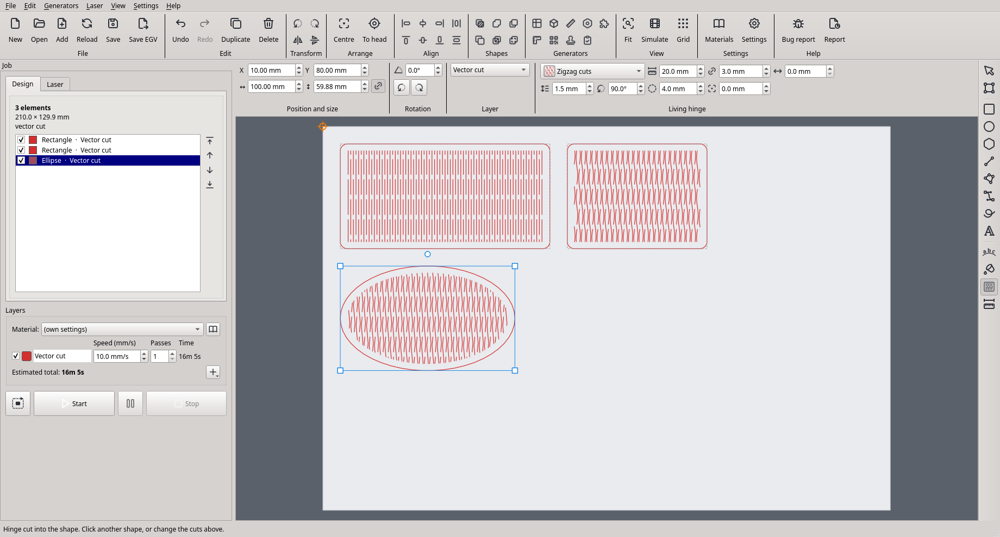

**Bridges (tabs).** A closed shape on a cut layer can keep small uncut
bridges that hold the part in the sheet: set their number and width in the
**Bridges** section.

**Element list.** The **Design** tab lists all elements with the colours of
their layers. Click a row to select it on the bed (Ctrl / Shift: several);
untick it to leave it out of the job. An opened file is listed with its
folder (**Customer A › design.svg**), so files of the same name from different
folders can be told apart, and the bottom bar shows the folders and file of
the design under the mouse pointer (or of the selected one); the whole path
is in its tooltip. Saved projects keep where each file came from.

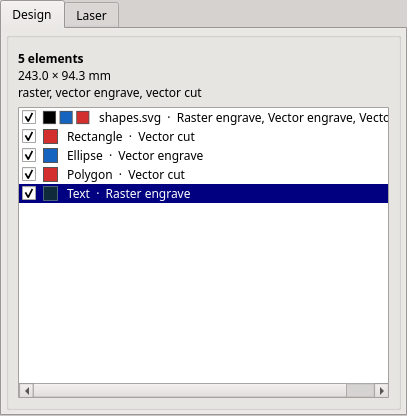

**Generators.** The **Generators** group of the toolbar (and the
**Generators** menu) makes ready designs from a few numbers. Each one opens a
window with its settings and a preview; Enter in a field updates the
preview, **Insert** puts the design on the bed at the laser head as one
group (drag it into place; one **Undo** takes it away). The last numbers are
remembered.

- **Material test**: a grid of fields, each with its own speed (columns) and
  power or number of passes (rows), each field on a layer of its own, the
  values engraved beside them. Cut or engrave it, then pick the best field.
  Power changes only on M3 boards; on other boards the rows change the passes.
- **Finger-joint box**: bottom, four walls and a lid (or an open box) that fit
  together with fingers; outside or inside sizes, material thickness, finger
  width and the kerf (the parts grow by half of it so the fingers fit
  tightly). The parts are laid out to fit the bed; those that do not fit go
  on a next sheet (**Sheet 2**, …), at the same place on its own unticked cut
  layer: cut sheet 1, change the material, tick the next sheet. **Each part on
  its own layer** puts every part on a cut layer of its own.
- **Kerf test**: a comb cut into pieces (push them together and measure:
  kerf = (length − measured) / pieces) and a plate with slots of the
  material's thickness plus a clearance each, to find the tightest fit.
- **Gear**: a spur gear with involute teeth (teeth, module, pressure angle)
  and a hole for the axle.
- **Puzzle**: a jigsaw puzzle cut of any size and number of pieces, with
  round tabs; **Variant** turns the tabs other ways.
- **Ruler**: a mark every millimetre, numbers every centimetre.
- **QR code**: a text or web address as a code to engrave (raster).
- **Stamp**: a rubber stamp. Choose the size (usual self-inking sizes or your
  own), type the text in the small editor above the preview (select a part
  and press **B** bold, **I** italic, **U** underline, **A+ / A−** bigger or
  smaller, or align the lines: for example the name big and bold, the address
  smaller), choose the font, a picture (logo) and a frame, then
  **Generate stamp**: the colours are inverted (the background is burnt away,
  the text stays raised) and the stamp is mirrored, so it prints the right
  way round. A cut line around it cuts the stamp out of the rubber.
- **Round stamp**: the same for a round stamp: a diameter (usual sizes or
  your own), text around the top and the bottom with a dot on each side, an
  outer and an inner ring, and text lines or a picture in the middle. Both
  ring texts get the same letter height, as large as fits.
- **Test card**: every operation on a piece of 3 mm plywood (a 50 mm square
  with a 20 mm hole, a 100 mm ruler, raster, patterns, a hinge, text on a
  path, bridges), to check the laser.

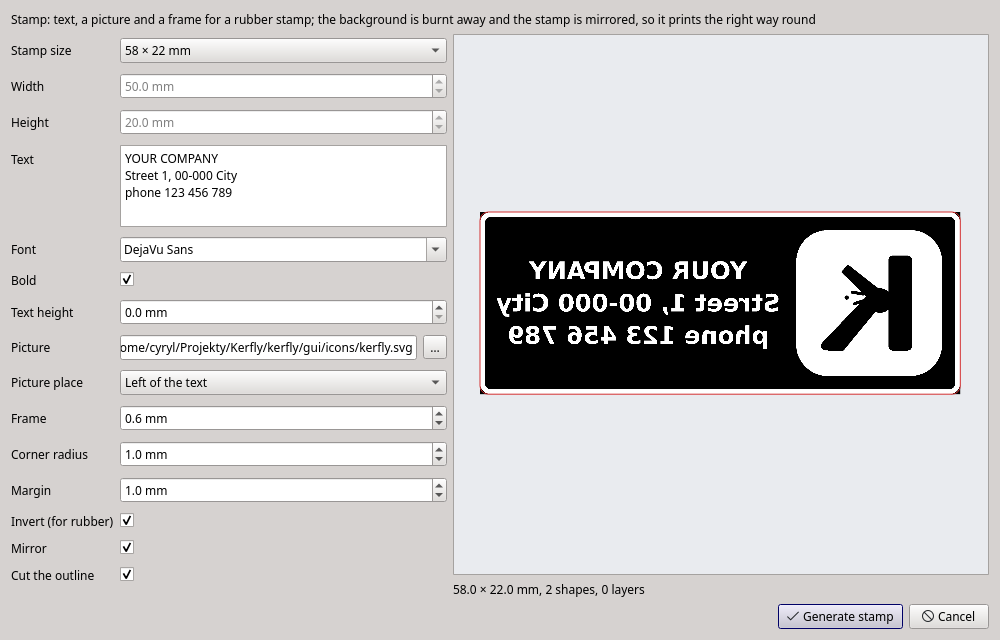

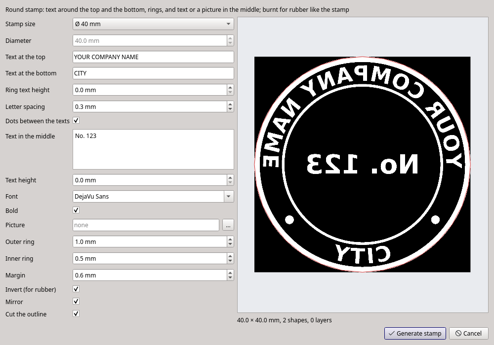

## 6. Layers and materials

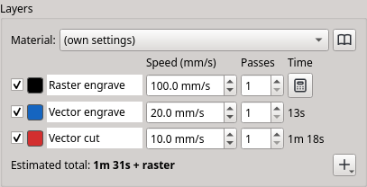

Every element has up to three parts: a **raster engrave** part (pictures and
fills), a **vector engrave** (outline) part and a **vector cut** part. Each
part goes to a **layer**. A layer has its own speed, number of passes,
power (M3 boards with power control) and colour. Untick a layer to leave it
out of the job.

- **The layer decides what the laser does.** Select a drawn shape and choose
  its layer in the **Layer** list of the options bar: a cut layer cuts it, an
  outline layer engraves its outline (and its pattern fill), a raster layer fills it.
- **More layers.** The **+** button under the layers adds another cut,
  outline or raster layer, for example a second cut layer with another speed.
  Layers run in the order raster, outline, cut.
- **Kerf.** The laser burns away a thin line, so a part cut along its
  outline comes out a little smaller and its holes a little larger. Type the
  width of the cut into the **Kerf** column of a cut layer (measure it with
  **Generators → Kerf test**): the outlines are cut half of it further out and
  the holes half of it further in, so the parts come out at their drawn size.
  Open lines are cut as drawn. 0 switches it off. The material library keeps
  a kerf for each material too.
- **Time.** The **Time** column shows how long each layer takes; for raster
  layers press the calculator button. **View → Simulate job…**
  (Ctrl+Shift+J) plays the head's moves on the bed: what the laser has burnt
  so far turns red (an engraved picture only where it is dark), moves with
  the laser off are grey dashed lines.
- **Materials.** **Settings → Material library…** stores speeds, passes and
  powers per material (for example "Plywood 3 mm"). Choosing a material in
  the **Material** list above the layers sets all layers at once.
  **New from current layers** saves every layer of the job: besides the three
  basic ones, extra layers (a second cut, another engraving…) are kept under
  **Other layers** by their names, and applying the material sets them again
  or adds them. The library can be exported and imported to share it.

## 7. Running a job

1. Connect and home the laser, put the material in and focus.
2. Place the design on the bed (or let it follow the head, see section 3).
3. **Trace boundary** (the dashed-outline button, Laser menu) drives the head
   around the design, with the laser off unless set in the settings, so you
   can check where it will be cut. It runs round the rectangle around the
   design, starting at the corner nearest the head (Settings → Vector: switch
   off "Boundary trace as a rectangle" to follow the outline instead).
4. **Start** (F9) runs all ticked layers. **Pause** stops the laser for a
   moment and the same button resumes it. **Stop** (Esc) ends the job
   immediately; then press **Home** before the next job. These buttons stay
   at the bottom of the left panel, also when it scrolls on a small screen.
   The mouse wheel changes a number field or a list only after you click
   into it, so scrolling the panel cannot change a speed by accident.
   To run one kind of work at a time (for example engrave first, check it,
   then cut), switch on **Engrave, Outline and Cut buttons next to Start** in
   Settings → View: **Engrave only**, **Outline only** and **Cut only** run all
   the ticked layers of that kind, each with its own settings (also in the
   Laser menu). Their tooltips show how long their part takes.
5. The progress bar at the bottom shows the percentage of the current step
   (preparing the data, sending it to the laser).

**Safety check.** Before anything is sent, Kerfly checks that the head stays
on the bed during the whole job and the trace. If it would leave the bed by
more than 1 mm, nothing is sent and the status bar says which edge and by how
much.

**Test fire** (M3 boards, Laser tab): fires the laser briefly with the power
and time set next to the button.

**EGV files.** **File → Save EGV file…** writes the job to a file (not with
M3 power per operation); **File → Send EGV file to laser…** sends an existing
EGV file.

## 8. Settings

**Settings → Settings…** (Ctrl+,) has six tabs:

| Tab | Settings |
|---|---|
| Machine | controller board, units, bed size, home in the upper right corner, home when connecting, home the head after a job (back to 0, 0, for the next piece), unlock the rail and beep after a job, X/Y scale factors, M3 power per operation and maximum power |
| Raster | halftone (dither) and its resolution, invert colours, mirror, rotate 90°, engrave bottom to top, scan line step, levels curve |
| Vector | cut inside shapes first, boundary trace with the laser on, as a rectangle or along the outline, trace gap and speed |
| View | snap grid size (0: off), snap to other objects, the design follows the laser head (these three are also remembered by themselves when changed in the View menu), Engrave / Outline / Cut buttons next to Start |
| Rotary | rotary attachment, its scale factor and rapid speed |
| Advanced | language (after a restart), checking for new versions, Inkscape, reduced memory use, USB data preparation, waiting for the laser, USB timeout and retries |

Kerfly is available in English, Polish, German, Spanish and French.

**New versions.** Once a day at start Kerfly asks GitHub, where it is
published, whether a new version is out (nothing about you or your work is
sent). When there is one, a bar above the bed says so: **See the release**
opens its page with what is new and the files to download, **Later** hides
the bar, **Skip this version** stops reminding about it. **Help → Check for
updates** (toolbar **Updates**) asks at once. Don't want it? Untick it in
Settings → Advanced. Kerfly never downloads or installs anything by itself.

## 9. Keyboard shortcuts

| Keys | Action |
|---|---|
| Ctrl+N | New project |
| Ctrl+O / Ctrl+Shift+O | Open design / add design |
| F5 | Reload design |
| Ctrl+S / Ctrl+Shift+S | Save project / save project as |
| Ctrl+Shift+E | Save EGV file |
| Ctrl+Z / Ctrl+Shift+Z | Undo / redo |
| Ctrl+D / Del | Duplicate / delete |
| Ctrl+C / Ctrl+X / Ctrl+V | Copy / cut / paste (at the mouse pointer when it is over the bed) |
| Ctrl+Alt+V | Paste in place (where the elements were) |
| Ctrl+A / Esc (on the bed) | Select all / select nothing |
| Ctrl+L / Ctrl+R, also Ctrl+[ / Ctrl+] | Rotate 90° left / right |
| Ctrl+Shift+H / Ctrl+Shift+V, also H / V on the bed | Mirror horizontally / vertically |
| Ctrl+G / Ctrl+Shift+G | Group / ungroup |
| Ctrl++ / Ctrl+- / Ctrl+* / Ctrl+^ | Union / difference / intersection / exclusion |
| Ctrl+E | Centre on the bed |
| PgUp / PgDown | Move up (earlier) / down (later) in the element list (Ctrl: to the start / end) |
| Ctrl+H | Place design at the head |
| Ctrl+Alt+H | Design follows the head (on / off) |
| Arrow keys (Shift: ×10) | Move the selected element |
| Ctrl+arrow keys | Move the laser head by one step |
| Ctrl+7, 9, 5, 1, 3 | Head to the design's upper left, upper right, centre, lower left, lower right |
| Ctrl+Alt+G | Go to the X/Y position |
| Ctrl+I | Connect to the laser |
| Home | Home the head |
| F9 / Esc | Start / stop |
| Ctrl+0 | Fit the bed to the window |
| Ctrl+Shift+J | Simulate the job |
| Ctrl+' / Ctrl+; | Snap to grid / snap to objects |
| Alt (held) | Snap to nothing for a moment |
| Ctrl+, | Settings |
| F1 | This user guide |
| S, N, R, E, P, L, Shift+L, B, F, T, Shift+T, Shift+F, Shift+H, Shift+O, M | Tools (see section 5) |

## 10. When something goes wrong

**Help → User guide** (F1) opens this guide.

- **Help → Report a problem on GitHub…** (toolbar **Bug report**) saves a
  diagnostic report and opens the report form with your version, system and
  board filled in. Drag the report file into the form's *Diagnostic report*
  field. You can write in English or Polish. A free GitHub account is needed.
- **Help → Save diagnostic report…** (toolbar **Report**) only saves the
  report: settings, self-test and the log of everything sent to the laser.
- **Help → Open the log folder** shows `kerfly.log`.

Common problems:

| Problem | What to do |
|---|---|
| "Laser is not initialized" | Press the plug button (Ctrl+I). On Linux choose **Laser → Allow USB access for the laser…**; on Windows check the libusb driver |
| The head is not where the program shows it | Press Home. This happens after Unlock rail, after moving the head by hand and after Stop |
| An element is drawn red, Start does not work | The element sticks out of the bed: move it back |
| SVG text is missing or not cut | Install Inkscape: it turns SVG text into paths |
| The laser stops responding | **Laser → Unfreeze laser**, then **Release USB** and connect again |
