# Instrukcja obsługi Kerfly

Kerfly steruje laserami CO2 klasy K40 z płytami Lihuiyu (rodzina M2 Nano):
układa projekty na stole lasera, pozwala je rysować i edytować oraz wysyła
zadanie do lasera. Instrukcja dotyczy wersji 1.4.

> Zawsze trzymaj rękę przy wyłączniku lasera i nigdy nie zostawiaj
> pracującego lasera bez nadzoru.

- [1. Pierwsze uruchomienie](#s1)
- [2. Okno programu](#s2)
- [3. Przesuwanie głowicy](#s3)
- [4. Otwieranie plików](#s4)
- [5. Rysowanie i edycja](#s5)
- [6. Warstwy i materiały](#s6)
- [7. Uruchamianie zadania](#s7)
- [8. Ustawienia](#s8)
- [9. Skróty klawiszowe](#s9)
- [10. Gdy coś nie działa](#s10)

## 1. Pierwsze uruchomienie

1. Zainstaluj Kerfly według
   [instrukcji instalacji](https://github.com/cyryllo/Kerfly/blob/main/INSTALL_pl.md),
   ze [strony wydań](https://github.com/cyryllo/Kerfly/releases):
   - **Windows 10 / 11:** uruchom `Kerfly-<wersja>-windows-setup.exe`.
     Instalator nie jest podpisany, więc Windows może pokazać „System Windows
     ochronił ten komputer”: wybierz **Więcej informacji → Uruchom mimo to**.
     Za pierwszym razem zaznacz sterownik USB dla lasera K40.
   - **Linux:** nadaj plikowi `Kerfly-<wersja>-x86_64.AppImage` prawo
     uruchamiania i uruchom go. Raz zezwól na dostęp do portu USB lasera:
     **Laser → Zezwól na dostęp do USB lasera…** (zapyta o hasło), potem
     podłącz laser ponownie.
   - **macOS** (wersja wstępna): otwórz plik `.dmg` i przeciągnij Kerfly do
     Aplikacji; pierwsze uruchomienie przez **Ustawienia systemowe →
     Prywatność i ochrona → Otwórz mimo to** (opisuje to instrukcja
     instalacji). USB nie potrzebuje sterownika.
2. Sprawdź instalację autotestem (w wierszu poleceń / terminalu):
   - z instalatora Windows: `"C:\Program Files\Kerfly\kerfly-console.exe" --self-test`
   - AppImage: `./Kerfly-<wersja>-x86_64.AppImage --self-test`
   - macOS: `/Applications/Kerfly.app/Contents/MacOS/Kerfly --self-test`

   Każda linia powinna mieć `OK`; linie `WARN` dotyczą rzeczy opcjonalnych
   albo niepodłączonego lasera.
3. Otwórz **Ustawienia → Lasery…**, wybierz **Płytę sterującą** swojego
   lasera (napis na płycie, np. LASER-M2 albo LASER-M3) i **rozmiar stołu**,
   potem **Zapisz**. **Jednostki** (mm albo cale) są w **Ustawienia →
   Ustawienia… → Widok**.
4. Włącz laser, podłącz kabel USB i naciśnij **Połącz** (Ctrl+I) na
   zakładce **Laser**. Domyślnie Kerfly od razu bazuje
   głowicę (przesuwa ją do lewego górnego rogu).

Kerfly trzyma ustawienia w pliku `k40_whisperer.txt` w folderze domowym.
Zmienione ustawienia zachowasz przez **Plik → Zapisz ustawienia jako
domyślne**. Język, siatka, przyciąganie i „projekt podąża za głowicą”
zapamiętują się od razu, bez zapisywania.

## 2. Okno programu

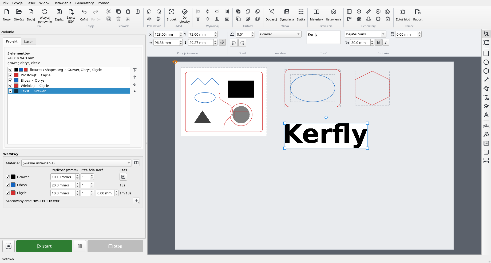

- **Wstążka** (góra), w podpisanych grupach: **Plik** (Nowy, Otwórz, Dodaj,
  Zapisz; małe przyciski Wczytaj ponownie, Zapisz EGV i G-code), **Edycja**
  (Cofnij, Ponów; schowek, duplikuj, usuń, zaznacz wszystko, grupuj, edytuj
  węzły),
  **Układ** (wyrównaj, rozłóż, obróć, odbij, wyśrodkuj, ułóż na stole, do
  głowicy), **Kształty** (łączenie kształtów, polilinia), **Widok** (Dopasuj,
  Symulacja, Siatka) i **Narzędzia** (**Generatory** z listą wszystkich
  generatorów, Materiały, Ustawienia). Po najechaniu myszą na mały przycisk
  widać, co robi. Zgłaszanie problemu jest w menu **Pomoc**.

  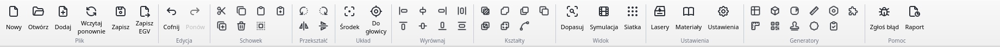

- **Pasek opcji** (pod wstążką, przez całe okno), dwa wiersze: pierwszy
  zawsze pokazuje **zaznaczenie**: pozycję (X, Y), rozmiar (Szer., Wys.;
  łańcuch zachowuje proporcje), obrót i **Warstwę**; drugi opcje tego, co
  edytujesz, z nazwą pogrubioną po lewej (np. treść tekstu, czcionkę, rozmiar
  i odstęp liter). Każde pole ma ikonę, krótki podpis i podpowiedź. Gdy
  wiersz nie mieści się w oknie, wiersze przewijają się w bok.

  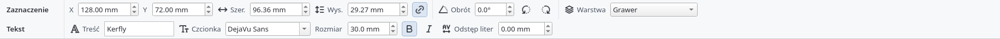

- **Panel po lewej**: zakładka **Projekt** ma **Elementy** (z ich liczbą i
  rozmiarem; na czerwono, gdy projekt wystaje poza stół) i **Warstwy**;
  zakładka **Laser** ma laser w użyciu i przesuwa głowicę. Na dole, przy obu
  zakładkach, przyciski zadania: **Obrys**, **Start**, **Pauza** i **Stop**.
- **Pasek stanu** (dół): komunikaty, miejsce kursora myszy na stole (od
  pozycji bazowej, jak pola X i Y), rozmiar stołu, powiększenie (100%: cały
  stół) i stan połączenia z laserem.
- **Stół** (środek): stół lasera z Twoimi elementami. Pomarańczowy celownik
  to głowica lasera. Elementy wystające poza stół są rysowane na czerwono i
  zadanie nie ruszy, dopóki ich nie przesuniesz z powrotem.
- **Narzędzia** (prawa strona), w trzech grupach: zaznaczanie (edycja węzłów
  jest w grupie Edycja na wstążce); rysowanie (prostokąt, elipsa, wielokąt, linia, łamana,
  pióro, odręcznie, tekst); operacje na kształtach (tekst na ścieżce,
  wypełnienie wzorem, zawias giętki, miarka).

Mysz na stole: kółko przybliża i oddala (nie dalej niż cały stół); środkowy
albo prawy przycisk przesuwa widok; **Ctrl+0** dopasowuje stół do okna.
**Kliknięcie prawym przyciskiem** (bez przeciągania) otwiera menu: na elemencie
jego polecenia (kopiuj, wytnij, wklej, duplikuj, usuń, grupuj, **Warstwa** ▸
przenosi wszystkie zaznaczone elementy naraz na inną warstwę, łączenie
kształtów, odsunięcie, kolejność, wyrównanie, obrót, odbicie, wypełnienie,
edycja węzłów, wyśrodkowanie, pominięcie w zadaniu); na pustym stole
**Przesuń głowicę tutaj** (gdy laser jest podłączony), wklej, zaznacz
wszystko, dopasuj widok, siatka.

## 3. Przesuwanie głowicy

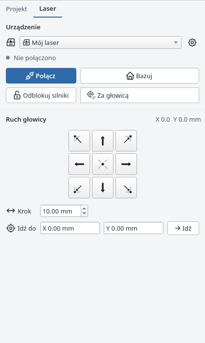

Zakładka **Laser** ma **Urządzenie** (laser w użyciu, stan połączenia,
przyciski maszyny) i **Ruch głowicy** (strzałki, krok, idź do X / Y). Na
górze jest lista **Twoich laserów**: przy dwóch laserach (np. laptop
przenoszony od jednego do drugiego) wybierasz ten, z którym pracujesz, i jego
ustawienia (płyta, rozmiar stołu, pozycja bazowa, skala, moc, oś obrotowa,
objazd konturu, programy przed zadaniem i po nim) trafiają do okna. Zębatka
obok listy (albo **Ustawienia → Lasery…**) otwiera **Twoje lasery i ich
ustawienia**: lista po lewej (Nowy, Powiel, Importuj), nazwa zaznaczonego lasera
(wpisz nową i naciśnij Enter) i jego ustawienia po prawej, pod nimi Eksportuj i Usuń. Możesz tam
zmienić każdy laser, także ten, który nie jest w użyciu: zmiany zostają przy
przechodzeniu między laserami, **Zapisz** je zapisuje (lasera w użyciu od razu
trafiają do okna), **Anuluj** je porzuca, **Użyj tego lasera** przełącza na
zaznaczony. W danej chwili pracuje się z jednym laserem.
**Dwa lasery podłączone do jednego komputera** (beta): Ustawienia → Lasery… →
**Port USB** zapisuje port płyty każdego lasera w jego profilu (**Który to?**
przesuwa głowicę tego lasera trochę w prawo i z powrotem). Bez zapamiętanego
portu, gdy podłączone są dwa lasery, Kerfly pyta, z którym się połączyć, i
zapamiętuje odpowiedź. Na Linuksie port się nie zmienia, dopóki kabel jest w
tym samym gnieździe; na Windows Kerfly może zapytać ponownie po przepięciu
kabla albo restarcie.

| Przycisk | Co robi |
|---|---|
| Wtyczka (po lewej od strzałek) | **Połącz** z laserem (Ctrl+I); wtyczka i kropka pod listą laserów robią się zielone |
| Domek | **Bazuj**: przesuwa głowicę do pozycji bazowej |
| Otwarta kłódka | **Odblokuj silniki**: zwalnia je, żeby przesunąć głowicę ręką |
| Celownik z łańcuchem | **Projekt podąża za głowicą** (Ctrl+Alt+H, wciśnięty po włączeniu), opis niżej |
| Strzałki | Przesuwają głowicę o jeden **Krok** (pole pod strzałkami). **Ctrl+strzałki** na klawiaturze robią to samo |
| Kropkowane narożniki i środek | Przesuwają głowicę do tego narożnika albo środka projektu, żeby zobaczyć, gdzie będzie cięcie. Projekt się nie przesuwa. Ctrl+7, Ctrl+9, Ctrl+5, Ctrl+1, Ctrl+3 |
| Idź do X / Y, **Idź** | Bazuje, a potem jedzie głowicą do tej pozycji (odległość od pozycji bazowej; Ctrl+Alt+G) |

Same strzałki na klawiaturze (bez Ctrl) przesuwają **zaznaczony element** na
stole, nie głowicę.

**Gdzie zaczyna się zadanie.** Projekt zostaje tam, gdzie leży na stole (jak w
LightBurnie czy MeerK40t): na początku zadania głowica najpierw podjeżdża do
projektu. Jeśli wolisz, żeby projekt zaczynał się przy głowicy:

- **Edycja → Ustaw projekt przy głowicy** (Ctrl+H, **Do głowicy** w grupie Układ)
  jednorazowo przesuwa projekt do głowicy: do głowicy trafia róg projektu
  odpowiadający rogowi bazowania lasera (lewy dolny dla lasera bazującego w
  lewym dolnym rogu; Ustawienia → Lasery… → Róg bazowania).
- **Projekt podąża za głowicą** (przycisk z łańcuchem, wciśnięty po
  włączeniu) trzyma projekt przy głowicy: strzałki, Idź do X/Y i Bazowanie
  przesuwają głowicę razem z projektem, a strzałki nie wypchną projektu poza
  stół. Przyciski narożników nadal przesuwają tylko głowicę; potem strzałki
  przesuwają projekt razem z głowicą, a głowica zostaje w tym samym miejscu
  projektu (np. w jego lewym górnym rogu, żeby sprawdzić projekt względem
  krawędzi materiału).

K40 nie podaje, gdzie jest głowica. Kerfly liczy ruchy, które wysłał; po
odblokowaniu osi, ręcznym przesunięciu głowicy albo zatrzymaniu zadania
naciśnij **Bazowanie** przed następnym zadaniem. Po zatrzymanym zadaniu
Kerfly przypomina o tym na pasku stanu.

## 4. Otwieranie plików

**Plik → Nowy projekt** (Ctrl+N, **Nowy** na wstążce) zaczyna od pustego stołu i
domyślnych warstw (najpierw pyta o zapisanie niezapisanych zmian).
**Plik → Otwórz projekt…** (Ctrl+O) zastępuje wszystko na stole;
**Plik → Dodaj projekt…** (Ctrl+Shift+O) kładzie kolejny plik obok
pozostałych.

| Plik | Co z niego powstaje |
|---|---|
| SVG | Czerwone linie są cięte, niebieskie grawerowane jako obrys, a cała reszta (wypełnienia, obrazy, czarne linie) grawerowana rastrowo. Kerfly używa Inkscape, jeśli jest zainstalowany, a bez niego własnego renderera; Inkscape jest potrzebny do tekstu w SVG, który ma być cięty albo grawerowany jako obrys |
| DXF | Linie cięcia; niebieskie obiekty i warstwy o nazwie *engrave* to obrys |
| PNG, JPG, BMP, TIFF, GIF, WebP | Grawer rastrowy: ciemne piksele są grawerowane. Kerfly pokazuje rozmiar obrazu; ustaw rozdzielczość albo szerokość i wysokość. **Wektoryzuj obrazek** (przycisk zaznaczonego obrazka albo Edycja → Wektoryzuj obrazek…) zamienia jego ciemne miejsca w ścieżki nałożone na obrazek, do cięcia, obrysu, wypełnienia wzorem albo edycji węzłów: ustaw próg, pomijanie drobinek, dokładność i gładkie krzywe, patrząc na obrysy na tle obrazka |
| G-code (.ngc, .gcode, .nc, .g, .tap) | Wykonywany jako G-code |
| Projekt Kerfly (.kerfly) | Cały układ, warstwy i narysowane kształty |

**Plik → Zapisz projekt** (Ctrl+S) zapisuje układ, warstwy, narysowane
kształty i kopie otwartych plików w jednym pliku `.kerfly`, który łatwo
przenieść na komputer przy laserze. **Wczytaj projekt ponownie** (F5) czyta
otwarte pliki jeszcze raz po zmianach w innym programie.

## 5. Rysowanie i edycja

Wybierz narzędzie po prawej (albo naciśnij jego klawisz) i rysuj myszą na
stole. Opcje narzędzia są na pasku opcji; możesz je zmienić przed
narysowaniem i po nim.

| Narzędzie | Klawisz | Jak |
|---|---|---|
| Zaznacz i przesuń | S | Klik zaznacza, przeciąganie przesuwa; uchwyty w narożnikach skalują, uchwyty na środkach boków zmieniają samą szerokość albo samą wysokość (przeciwległy bok zostaje), okrągły obraca. Ramka wokół kilku elementów albo Ctrl+klik zaznacza kilka |
| Edytuj węzły | N | Przeciągaj węzły i okrągłe uchwyty krzywych (Ctrl: jeden uchwyt osobno). Dwuklik na boku dodaje węzeł, na węźle go usuwa. Klawisze: I wstaw, D usuń, L linia, C krzywa, O gładki, S symetryczny, Z zamknij / otwórz, B rozdziel. Klik w puste miejsce stołu kończy edycję (powrót do zaznaczania) |
| Prostokąt | R | Przeciągnij. Shift: kwadrat. Opcja: promień rogów |
| Elipsa | E | Przeciągnij. Shift: koło |
| Wielokąt | P | Przeciągnij. Opcja: liczba boków |
| Linia | L | Przeciągnij. Shift: co 45° |
| Łamana | Shift+L | Klikaj narożniki. Klik w pierwszy punkt zamyka; dwuklik albo Enter kończy otwartą linię; Backspace usuwa ostatni narożnik; Esc anuluje |
| Pióro (krzywe) | B | Klik daje narożnik, wciśnięcie i przeciągnięcie gładką krzywą. Klik w pierwszy punkt zamyka; dwuklik albo Enter kończy |
| Odręcznie | F | Rysuj z wciśniętym przyciskiem; skończ blisko początku, żeby zamknąć kształt |
| Miarka | M | Przeciągnij między dwoma punktami: odległość, szerokość, wysokość i kąt |
| Tekst | T | Kliknij i wpisz tekst w polu **Treść**; wybierz czcionkę, rozmiar, pogrubienie i kursywę. Na górze listy czcionek: **czcionki jednokreskowe** wbudowane w Kerfly (Hershey, EMS), których litery to linie, po których laser przejeżdża raz: szybki, cienki grawer, bez wypełniania |
| Tekst na ścieżce | Shift+T | Wpisz tekst na pasku opcji, potem kliknij linię, krzywą albo kształt (opis niżej) |
| Wypełnij wzorem | Shift+F | Wybierz wzór na pasku opcji i klikaj zamknięte kształty, żeby je wypełnić (opis niżej) |
| Zawias giętki | Shift+H | Wybierz nacięcia na pasku opcji i klikaj zamknięte kształty, żeby naciąć w nich zawias (opis niżej) |
| Odsunięcie | Shift+O | Ustaw odległość na pasku opcji i klikaj zamknięte kształty, żeby narysować wokół nich nowy obrys (opis niżej) |
| Wytnij fragment obrazka | Shift+C | Przeciągnij prostokąt albo elipsę (pasek opcji) po obrazku: fragment w środku zostaje na swoim miejscu, reszta obrazka znika (Cofnij przywraca całość) |

**Przyciąganie.** Rysowanie i przesuwanie przyciąga do narożników, środków i
krawędzi innych elementów i do stołu (**Widok → Przyciągaj do obiektów**,
Ctrl+;) oraz do siatki, gdy jest włączona (**Widok → Przyciągaj do siatki**,
Ctrl+'; **Widok → Rozmiar siatki**). Przytrzymaj **Alt**, żeby na chwilę nic
nie przyciągało. Kerfly sam zapamiętuje na następny start siatkę (włączoną
albo nie i jej rozmiar), przyciąganie do obiektów i **Projekt podąża za
głowicą**; można je też ustawić w **Ustawienia → Widok**.

**Dokładne przesuwanie.** Wpisz pozycję, rozmiar i kąt na pasku opcji
(przycisk z łańcuchem zachowuje proporcje) albo użyj strzałek: 1 mm albo
jedno oczko siatki, z Shiftem 10 razy dalej.

**Układanie.** Menu **Edycja** i wstążka mają: cofnij i ponów
(Ctrl+Z, Ctrl+Shift+Z), kopiuj, wytnij i wklej (Ctrl+C, Ctrl+X, Ctrl+V: wkleja
pod kursorem, także do innego projektu; Ctrl+Alt+V wkleja w miejscu),
zaznacz wszystko (Ctrl+A), duplikuj (Ctrl+D), usuń (Del), obrót o 90° (Ctrl+L,
Ctrl+R), odbicie (Ctrl+Shift+H, Ctrl+Shift+V), wyśrodkowanie na stole
(Ctrl+E), wyrównywanie i rozkładanie oraz **Łącz kształty**: sumę, różnicę,
część wspólną i wykluczenie zamkniętych kształtów (różnica: pozostałe
zaznaczone kształty są wycinane z tego, który jest najwyżej na liście
elementów).

**Połącz w polilinię** (Ctrl+J, menu Edycja, grupa Kształty na wstążce, menu
pod prawym przyciskiem): zaznaczone linie, łamane i otwarte ścieżki, których
końce się stykają (bliżej niż 0,05 mm), stają się jedną ścieżką, ciętą
jednym ciągiem; łańcuch, który się domyka, jest zamknięty. Przydaje się przy
rysunkach z luźnych kawałków (z plików DXF): na laserze GRBL albo maszynie
CNC każdy kawałek to hamowanie i ponowne rozpędzanie. Zamknięte obrysy i
linie, które z niczym się nie stykają, zostają bez zmian. Otwarty plik:
najpierw go rozgrupuj.

**Ułóż na stole** (Ctrl+Shift+N, przycisk **Ułóż** w grupie Układ na wstążce,
menu Edycja, menu pod prawym przyciskiem): zaznaczone części (nic nie
zaznaczone: wszystkie; grupa jako jedna część) są rozkładane na stole lasera
z zadanym **odstępem**, obracane o 90°, gdy tak lepiej się mieszczą (wyłącz
**Obracaj o 90°** np. ze względu na słoje drewna). **Metoda**: **Prostokąty**
układa prostokąty wokół części (szybko); **Obrysy** (beta) układa ich
prawdziwe obrysy, więc części trafiają we wnęki innych i w wycięte w nich
otwory (otwór robią tylko linie cięcia: grawer wewnątrz części należy do
niej), biblioteką sparrow; szuka ciaśniejszego układu przez zadany **czas
szukania** (dla każdego arkusza, potem jeszcze połowę tego, żeby dosunąć
części arkusza razem do jego lewego górnego rogu; okienko pokazuje postęp, Anuluj zostawia
wszystko jak było). Co się nie zmieści, trafia na
kolejny arkusz (arkusz to zawsze pole robocze lasera): każdy arkusz jest
grupą na liście elementów, arkusze od 2. są odhaczone; wytnij arkusz 1, potem
go odhacz i zaznacz kolejny. Ponowne układanie rozkłada części od nowa.

**Odsunięcie.** Narzędzie **Odsunięcie** (Shift+O, także Edycja →
Odsunięcie) rysuje nowy obrys w zadanej odległości wokół kształtu. Na pasku
opcji ustaw **odległość** (dodatnia na zewnątrz, otwory się zmniejszają;
ujemna do środka), zaokrąglone albo ostre **narożniki** i **Zachowaj
oryginał** (wyłączone: nowy obrys zastępuje kształt), potem klikaj
zamknięte kształty na stole. Kształty zaznaczone przed wybraniem narzędzia
odsuwa przycisk **Odsuń zaznaczone**. Przydaje się do obwódki wokół
napisu, ramki wokół części albo mniejszej kopii w środku.

**Kolejność.** Lista elementów to kolejność zadania: w każdej warstwie laser
najpierw wykonuje element z góry listy. (Same warstwy zawsze idą w kolejności:
grawer, obrys, cięcie.) Kształty wewnętrzne zawsze są cięte przed
zewnętrznymi, żeby część nie wypadła przed wycięciem otworów: wewnątrz
jednego elementu, a także gdy kształt leży w środku cięcia innego elementu
(kółko narysowane po kwadracie, w którym leży).
Przyciski ze strzałkami obok listy elementów (zakładka Projekt) przesuwają
zaznaczone elementy: **Wyżej (wcześniej)** i **Niżej (później)** o jedno
miejsce (PgUp, PgDown, gdy aktywny jest stół), **Na początek** i **Na koniec**
na górę albo na dół listy (Ctrl+PgUp, Ctrl+PgDown). Grupy przesuwają się razem.

**Grupy.** **Grupuj** (Ctrl+G) sprawia, że kilka elementów przesuwa
się razem; klik w jeden z nich zaznacza całą grupę, drugi klik tylko ten
element. Grupy mogą zawierać grupy: na liście elementów grupa to wiersz,
który się rozwija i zwija, z jej elementami (i grupami) w środku; ptaszek
przy grupie włącza ją całą do zadania albo ją wyłącza, a klik w jej wiersz
zaznacza tylko tę grupę (na przykład jeden arkusz pudełka), klik w wiersz
elementu tylko ten element. **Rozgrupuj**
(Ctrl+Shift+G) zdejmuje jeden poziom (grupy w środku zostają grupami), a
także dzieli otwarty plik SVG albo DXF: każda jego linia staje się kształtem
do edycji, a obrazy dzielą się na osobne części. Dwuklik na dowolnym
elemencie otwiera edycję węzłów.

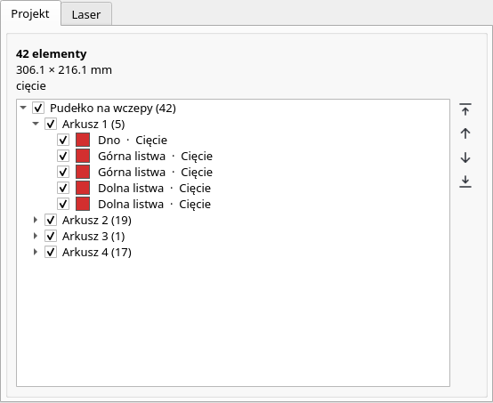

**Wypełnienia wzorami.** Narzędzie
**Wypełnij wzorem** (wiaderko, Shift+F) wypełnia zamknięte kształty
grawerowanymi liniami we wzór: linie, krzyżowe, fale, zygzak, okręgi, plaster
miodu, romby, cegły, koncentryczny (pierścienie idące za obrysem do
środka), trójkąty, jodełka, łuski, fale prostokątne, spirala, promienie,
kropki, krzyżyki, kafelki Truchet albo krzywa Hilberta.

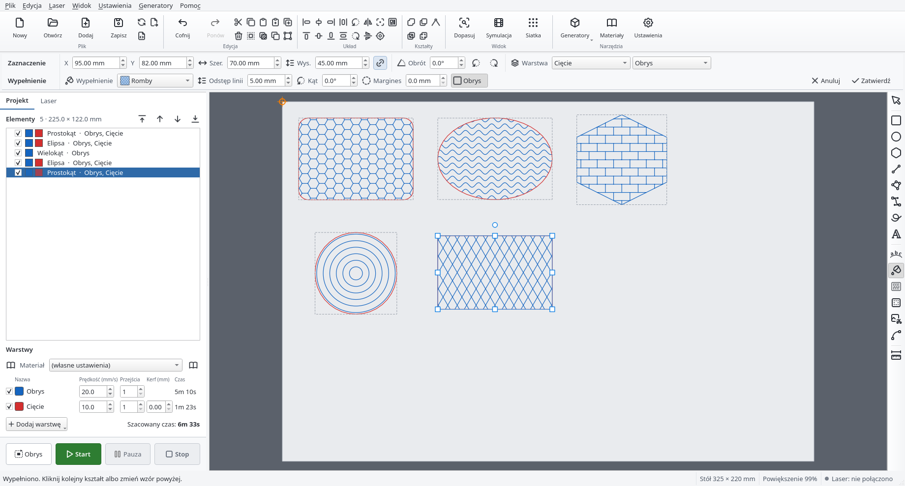

1. Wybierz narzędzie i wzór w polu **Wypełnienie** na pasku opcji. Ustaw
   jego rozmiar (odstęp między liniami), kąt i margines, czyli wolne miejsce
   wewnątrz obrysu.
2. Kliknij zamknięty kształt na warstwie cięcia albo obrysu. Klikaj kolejne,
   żeby też je wypełnić; zaznaczone kształty od razu dostają wybrany wzór.
   Gdy kształty są zaznaczone, pasek opcji pokazuje, co mają teraz (**Bez
   wzoru** dla kształtów bez wzoru); narzędzie **Zawias giętki** działa
   tak samo.
3. Obrys zostaje na swojej warstwie: kształt do cięcia dalej jest cięty, a wzór
   jest grawerowany na warstwie obrysu (dla kształtu do cięcia druga lista
   **Warstwa** wybiera, na której). Przycisk **Obrys** obok pól wzoru
   wyłącza obrys, wtedy graweruje się sam wzór: **Linie** albo **Krzyżowe**
   bez obrysu wypełniają obszar grawerowanymi liniami (przed wersją 0.17 była
   to osobna sekcja Kreskowanie; starsze projekty otwierają się właśnie tak).

Zaznaczony kształt pokazuje te same pola **Wypełnienia** także przy
narzędziu zaznaczania: tam zmienisz wzór albo wybierzesz **Bez wzoru**, żeby go
usunąć. Dziury w kształcie (np. w literach) zostają puste. Otwarty plik SVG
albo DXF trzeba najpierw rozgrupować (Edycja → Rozgrupuj), żeby jego linie
stały się kształtami.

**Tekst na ścieżce.** Wybierz narzędzie
**Tekst na ścieżce** (Shift+T, łuk z literami po prawej), wpisz tekst i
wybierz czcionkę na pasku opcji, potem kliknij linię, krzywą albo kształt:
tekst stanie na nim, każda litera na linii i obrócona wzdłuż niej. Na otwartej
linii tekst jest wyśrodkowany, na zamkniętym kształcie wyśrodkowany na górze.
Jeśli przy kliknięciu zaznaczony jest jakiś tekst (np. napisany narzędziem
Tekst), to właśnie on przechodzi na kształt i nie zostaje żadna kopia.
**Przeciągnij tekst, żeby przesunąć go wzdłuż linii**; na okręgu jedzie
dookoła. Pasek opcji tekstu na ścieżce ma **Początek** (położenie na
ścieżce), **Od linii** (odległość od linii; poniżej zera litery przecinają
linię), przycisk **Druga strona** i **Prosty tekst**; pole **Odstęp liter**
dodaje odstęp między literami, także w zwykłym tekście. Po najechaniu myszą na pole widać, co
robi. Kształt
zostaje; usuń go, jeśli nie ma być cięty. Istniejący tekst ustawisz na
kształcie przez **Edycja → Umieść tekst na ścieżce** (zaznacz oba). Strzałki i
pola X/Y przesuwają tekst razem z jego ścieżką.

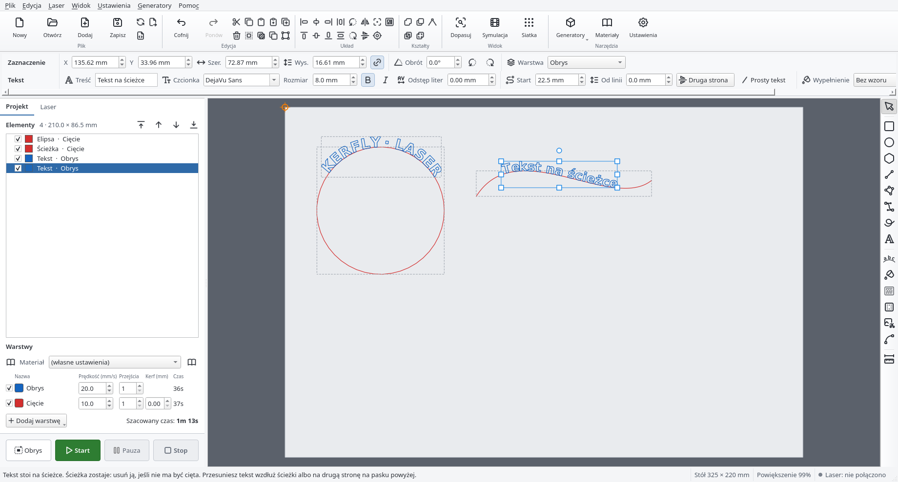

**Zawiasy giętkie.** Zawias giętki to
pole nacięć, dzięki którym sklejka albo MDF się wygina, np. na zaokrąglonych
rogach pudełka. Wybierz narzędzie **Zawias giętki** (Shift+H, arkusz z
nacięciami), wybierz nacięcia na pasku opcji (proste, faliste albo zygzakiem)
i kliknij zamknięty kształt: nacięcia zostaną wycięte w jego środku, przed
obrysem. Pola zawiasu na pasku opcji, każde z ikoną, podpisem i opisem po najechaniu,
ustawiają długość jednego nacięcia, **mostek** nieprzeciętego materiału między
dwoma nacięciami, odstęp rzędów (mniejszy bardziej się wygina), kierunek
nacięć (90°: góra–dół, arkusz wygina się w poprzek nich), **margines**
pełnego materiału na końcach zawiasu (w poprzek rzędów; domyślnie 0) oraz
**pas**: jego szerokość (0: cały kształt) i położenie
środka liczone od środka kształtu (minus: w lewo / w górę, plus: w prawo / w
dół), gdy zawias ma być tylko tam, gdzie arkusz się wygina. Rzędy idą na
zmianę: w jednym same długie nacięcia z mostkiem na obu końcach, w następnym
krótkie nacięcie od obrysu na każdym końcu i długie pomiędzy; nacięcia
dochodzą do obrysu, bo pełny brzeg wzdłuż niego nie pozwoliłby arkuszowi się
wygiąć. Zaznaczone kształty od razu dostają wybrany zawias; kształt z
zawiasem pokazuje te pola także przy narzędziu zaznaczania, gdzie **Bez
zawiasu** go usuwa. Najpierw spróbuj na małym kawałku: to, jak bardzo arkusz
się wygina, zależy od materiału.

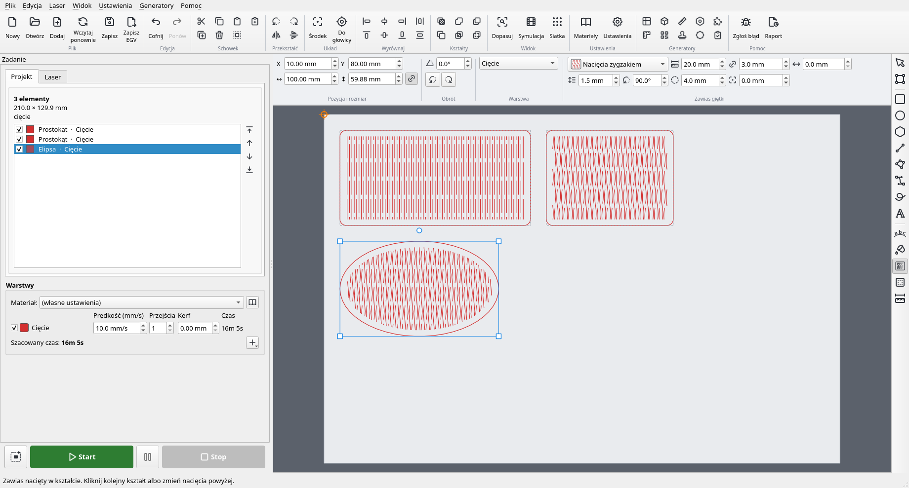

**Mostki.** Zamknięty kształt na warstwie cięcia może mieć małe nieprzecięte
mostki, które trzymają element w arkuszu: ustaw ich liczbę (**Mostki**) i
**Szer. mostka** na pasku opcji.

**Lista elementów.** **Elementy** na zakładce **Projekt** pokazują wszystkie elementy z
kolorami ich warstw. Klik w wiersz zaznacza element na stole (Ctrl / Shift:
kilka); odznaczenie pola wyłącza element z zadania. Otwarty plik jest
pokazany razem z folderem (**Klient A › projekt.svg**), więc pliki o tej samej
nazwie z różnych folderów łatwo odróżnić, a dolny pasek pokazuje foldery i
plik projektu pod kursorem myszy (albo zaznaczonego); pełna ścieżka jest w
podpowiedzi. Zapisane projekty pamiętają, skąd pochodzi każdy plik.

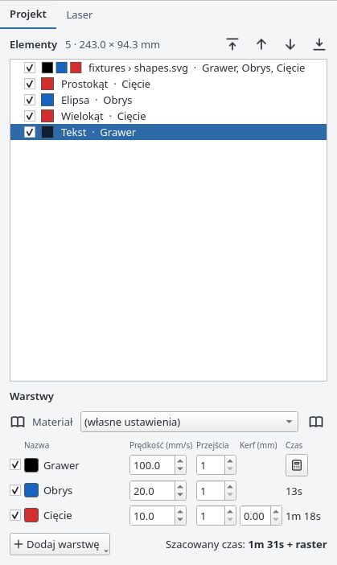

**Generatory.** Przycisk **Generatory** na wstążce (i menu **Generatory**),
w trzech częściach (pudełka, elementy, testy i kalibracja), tworzy gotowe
projekty z kilku liczb. Każdy otwiera okno z ustawieniami po lewej (znaczek
**beta** przy tym, czego jeszcze nie sprawdzono na laserze) i podglądem po
prawej, z rozmiarem i liczbą kształtów pod spodem; Enter w polu odświeża podgląd, a **Wstaw** kładzie
projekt na stole przy głowicy jako jedną grupę (przeciągnij go na miejsce;
jedno **Cofnij** go usuwa). Ostatnio użyte liczby są zapamiętywane.

- **Test materiału**: siatka pól, każde z własną prędkością (kolumny) i mocą
  albo liczbą przejść (rzędy), każde pole na osobnej warstwie, z
  wygrawerowanymi wartościami. Wytnij albo wygraweruj i wybierz najlepsze
  pole. Moc zmienia się tylko na płytach M3; na innych rzędy zmieniają liczbę
  przejść.
- **Pudełko na wczepy**: dno, cztery ścianki i wieko (albo otwarte pudełko)
  łączone wczepami; wymiary zewnętrzne lub wewnętrzne, grubość materiału,
  szerokość wczepu i kerf (części rosną o jego połowę, żeby wczepy pasowały
  ciasno). Części są układane tak, żeby mieściły się na stole; te, które się
  nie mieszczą, trafiają na kolejny arkusz (**Arkusz 2**, …), w tym samym
  miejscu, na tej samej warstwie cięcia. Na liście elementów pudełko jest
  jedną grupą z osobną grupą dla każdego arkusza (a każda część złożona z
  kilku kształtów, obrys i jego szczeliny, jest osobną grupą); arkusze od 2.
  są na początku odhaczone: wytnij arkusz 1, zmień materiał, odhacz arkusz 1
  i zaznacz kolejny. **Każda część na osobnej warstwie** daje
  każdej części jej własną warstwę cięcia. **Przegródki w poprzek / wzdłuż**
  (beta, jeszcze nie sprawdzone na laserze) dodają wewnętrzne ścianki
  rozłożone równo: ich wypusty wchodzą w szczeliny w ściankach i dnie, a
  krzyżujące się przegródki łączą nacięcia do połowy wysokości. **Wysuwane
  wieczko** (beta) wsuwa się od przodu w rowek między dwiema poziomymi
  listwami na każdej bocznej ściance; języczki listew wchodzą w szczeliny
  ścianki, a nad górną listwą zostaje pas ścianki wysoki co najmniej 3 mm, dla
  wytrzymałości. Przód jest niższy, więc wieczko przesuwa się nad nim. Części są układane tak, żeby
  dobrze wykorzystać stół: obracane, gdy to pomaga, i dokładane w wolne
  miejsca wcześniejszych arkuszy.
- **Okrągłe pudełko na zawiasie** (beta, jeszcze nie sprawdzone na laserze):
  dno i wieko z zaokrąglonymi rogami, ścianka z dwóch jednakowych pasków,
  które gną się na rogach dzięki zawiasowi giętkiemu; całość trzymają wypusty
  dna i wieka; bez wieka kształt ścianki u góry trzyma obrzeże. Szerokość,
  głębokość, wysokość, promień rogów, materiał,
  szerokość wypustu, kerf oraz długość nacięcia, mostek i odstęp rzędów
  zawiasu.

W obu pudełkach podgląd ma obok **Części** przełącznik **3D**: pudełko
złożone z tych samych części, które zostaną wycięte (wczepy, szczeliny,
listwy, przegródki). Przeciągnij, aby je obrócić, kółko myszy przybliża,
dwuklik przywraca widok. **Rozsunięte** odsuwa części od siebie, żeby było
widać, jak łączą się wczepy i języczki; **Ukryte krawędzie** pokazuje
krawędzie schowane za innymi częściami linią przerywaną, jak na rysunku
technicznym; przy wysuwanym wieczku suwak **Wysuń wieczko** wyciąga wieczko z
rowka.

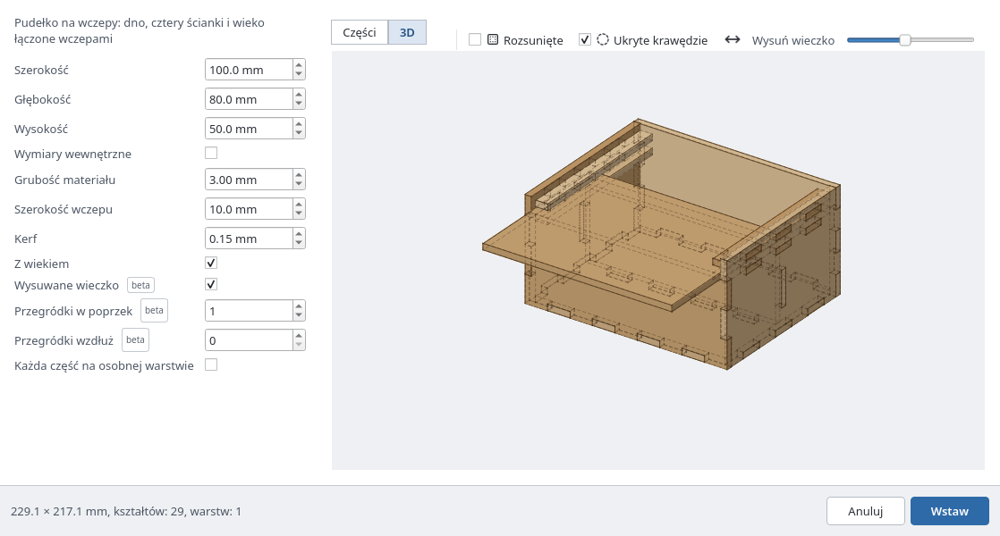
- **Test kerfu**: grzebień cięty na części (zsuń je i zmierz: kerf =
  (długość − zmierzone) / liczba części) i płytka ze szczelinami o grubości
  materiału plus luz, żeby znaleźć najciaśniejsze pasowanie.
- **Koło zębate**: walcowe, z zębami ewolwentowymi (liczba zębów, moduł, kąt
  przyporu) i otworem na oś.
- **Puzzle**: układanka dowolnej wielkości i liczby elementów, z okrągłymi
  wypustkami; **Wariant** odwraca wypustki.
- **Linijka**: kreska co milimetr, liczby co centymetr.
- **Kod QR**: tekst albo adres strony jako kod do graweru (raster).
- **Pieczątka**: gumowa pieczątka. Wybierz rozmiar (typowe pieczątki
  samotuszujące albo własny), wpisz tekst w małym edytorze obok podglądu
  (zaznacz fragment i naciśnij **B** pogrubienie, **I** kursywa, **U**
  podkreślenie, **A+ / A−** większe lub mniejsze litery albo wyrównaj
  wiersze: np. nazwa duża i pogrubiona, adres mniejszy), wybierz czcionkę,
  obrazek (logo)
  i ramkę, potem **Generuj pieczątkę**: kolory są odwracane (tło zostaje
  wypalone, tekst zostaje wypukły), a pieczątka odbita, żeby odbijała się
  prawidłowo. Linia cięcia dookoła wycina pieczątkę z gumy.
- **Pieczątka okrągła**: to samo dla pieczątki okrągłej: średnica (typowe
  rozmiary albo własna), tekst wokół góry i dołu z kropką po każdej stronie,
  pierścień zewnętrzny i wewnętrzny oraz wiersze tekstu albo obrazek w
  środku. Oba teksty w otoku mają tę samą wysokość liter, największą, jaka
  się mieści.
- **Karta testowa**: każda operacja na kawałku sklejki 3 mm (kwadrat 50 mm
  z otworem 20 mm, linijka 100 mm, raster, wzory, zawias, tekst na ścieżce,
  mostki), do sprawdzenia lasera.

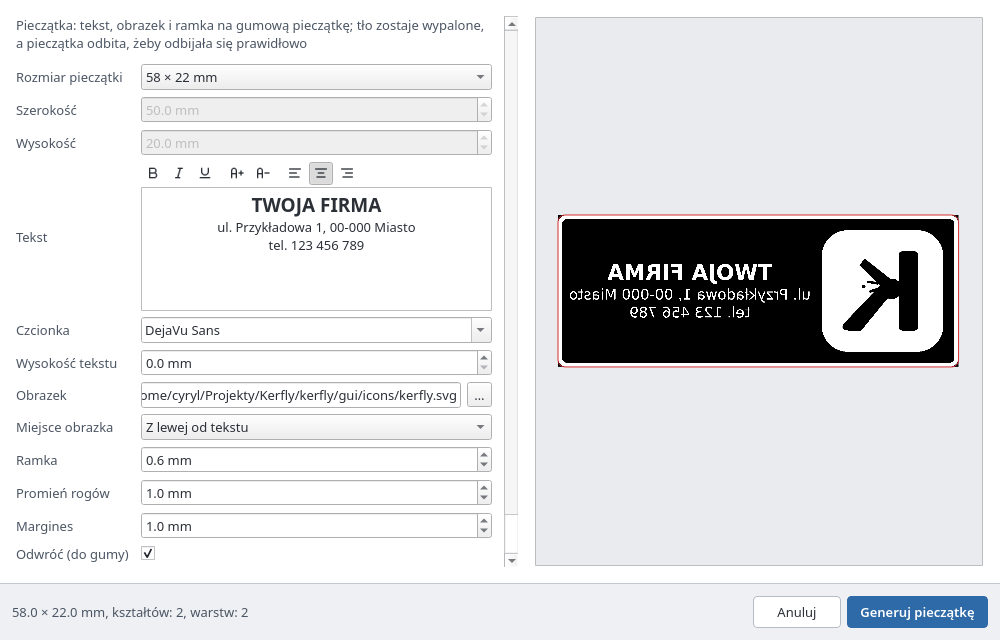

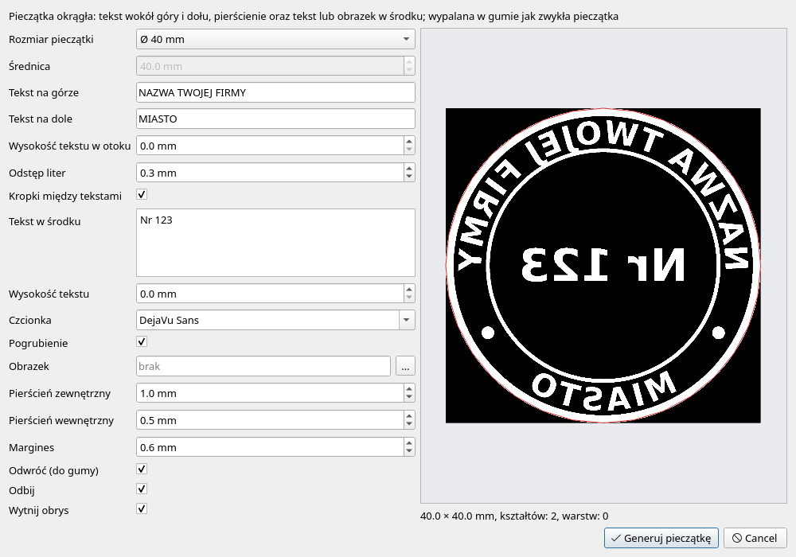

## 6. Warstwy i materiały

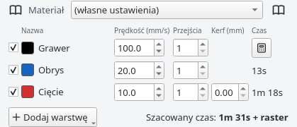

Każdy element ma do trzech części: **grawer** (rastrowy: obrazy i
wypełnienia), **obrys** (grawer wektorowy) i **cięcie**. Każda część trafia na
**warstwę**. Warstwa ma własną prędkość, liczbę przejść, moc (płyty M3 z
regulacją mocy) i kolor. Odznaczona warstwa nie wchodzi do zadania.

- **Warstwa decyduje, co robi laser.** Zaznacz narysowany kształt i wybierz
  jego warstwę na liście **Warstwa** na pasku opcji: warstwa cięcia go
  wycina, warstwa obrysu graweruje jego obrys (i wypełnienie wzorem), warstwa
  graweru go wypełnia.
- **Więcej warstw.** **Dodaj warstwę** pod warstwami dodaje kolejną warstwę
  cięcia, obrysu albo graweru, np. drugą warstwę cięcia z inną prędkością.
  Warstwy wykonują się w kolejności: grawer, obrys, cięcie.
- **Kerf.** Laser wypala cienką linię, więc część wycięta po obrysie wychodzi
  trochę mniejsza, a jej otwory trochę większe. Wpisz szerokość cięcia w
  kolumnie **Kerf (mm)** warstwy cięcia (zmierz ją: **Generatory → Test kerfu**):
  obrysy są cięte o jej połowę dalej na zewnątrz, a otwory o połowę dalej do
  środka, więc części wychodzą w narysowanym rozmiarze. Otwarte linie są
  cięte tak, jak narysowane. 0 wyłącza. Biblioteka materiałów też pamięta
  kerf dla każdego materiału.
- **Czas.** Kolumna **Czas** pokazuje czas każdej warstwy; dla graweru
  naciśnij przycisk z kalkulatorem; suma jest pod tabelą (jednostki kolumn
  są w ich nagłówkach). **Widok → Symulacja zadania…** (Ctrl+Shift+J,
  **Symulacja** na wstążce) otwiera osobne okno, które odtwarza ruchy głowicy:
  całe zadanie jest szare, to, co laser już wypalił, robi się czerwone
  (grawerowany obrazek tylko tam, gdzie jest ciemny), a ruchy z wyłączonym
  laserem to szare przerywane linie. Nad podglądem **Odtwórz** / **Pauza**,
  suwak, czas, **Tempo** (na start 5×, dla długiego zadania szybciej) i **Następna warstwa**; pod nim warstwa, która jest
  właśnie wypalana. Okno może zostać otwarte w czasie pracy: gdy projekt się
  zmieni, po chwili przelicza zadanie i zostaje w tym samym miejscu (z
  pauzą; mówi o tym napis). Nowy i Otwórz je zamykają.
- **Materiały.** **Ustawienia → Baza materiałów…** (przycisk z książką obok
  listy materiałów, **Materiały** na wstążce) zapamiętuje dla materiału (np.
  „Sklejka 3 mm”) jego grubość, tabelę prędkości, przejść, mocy i kerfu oraz
  notatki. Wybór materiału z
  listy **Materiał** nad warstwami ustawia wszystkie warstwy naraz.
  **Nowy z obecnych warstw** zapisuje wszystkie warstwy zadania: oprócz trzech
  podstawowych także dodatkowe (drugie cięcie, kolejny grawer…), widoczne w
  części **Inne warstwy** pod swoimi nazwami; zastosowanie materiału ustawia je
  z powrotem albo dodaje. Bazę można eksportować i importować, żeby się nią
  dzielić. **Każdy laser ma własną bazę**; lasery tego samego rodzaju mogą mieć
  wspólną: Ustawienia → Lasery…, **Baza materiałów** (kopia zrobiona przez
  Powiel na początku dzieli bazę z oryginałem).

## 7. Uruchamianie zadania

1. Połącz laser i zbazuj głowicę, włóż materiał i ustaw ostrość.
2. Ułóż projekt na stole (albo włącz „Projekt podąża za głowicą”, punkt 3).
3. **Objazd konturu** (przycisk z kreskowaną ramką, menu Laser) objeżdża
   głowicą projekt, z wyłączonym laserem, chyba że ustawisz inaczej w
   ustawieniach, żeby sprawdzić, gdzie będzie cięcie. Objeżdża prostokąt
   wokół projektu, zaczynając od narożnika najbliższego głowicy (Ustawienia →
   Lasery…, Objazd konturu: wyłącz „Objazd konturu jako prostokąt”, żeby
   jechać wzdłuż obwiedni).
4. **Start** (F9) wykonuje wszystkie zaznaczone warstwy. **Pauza** na chwilę
   zatrzymuje laser, a ten sam przycisk wznawia pracę. **Stop** (Esc)
   natychmiast kończy zadanie; potem naciśnij **Bazowanie** przed następnym
   zadaniem. Te przyciski zostają na dole lewego panelu, także gdy na małym
   ekranie panel się przewija. Rolka myszy zmienia pole liczbowe albo listę
   dopiero po kliknięciu w nie, więc przewijanie panelu nie zmieni
   przypadkiem prędkości. Żeby wykonać jeden rodzaj pracy naraz (np. najpierw
   grawer, sprawdzenie, potem cięcie), włącz **Przyciski Grawer, Obrys i
   Cięcie przy Start** w Ustawienia → Widok: **Tylko grawer**, **Tylko obrys**
   i **Tylko cięcie** wykonują wszystkie zaznaczone warstwy danego rodzaju,
   każdą z jej ustawieniami (są też w menu Laser). Podpowiedź przycisku
   pokazuje, ile potrwa jego część.
5. Pasek postępu na dole pokazuje procent bieżącego kroku (przygotowanie
   danych, wysyłanie do lasera).

**Kontrola bezpieczeństwa.** Zanim cokolwiek zostanie wysłane, Kerfly
sprawdza, czy głowica przez całe zadanie i objazd zostaje na stole. Jeśli
wyjechałaby poza stół o więcej niż 1 mm, nic nie zostanie wysłane, a pasek
stanu poda krawędź i odległość.

**Strzał testowy** (płyty M3, zakładka Laser): krótko odpala laser z mocą i
czasem ustawionymi obok przycisku.

**Pliki EGV.** **Plik → Zapisz plik EGV…** zapisuje zadanie do pliku (nie
przy mocy ustawianej dla każdej operacji na M3); **Plik → Wyślij plik EGV do
lasera…** wysyła istniejący plik EGV.

**G-code dla laserów GRBL.** **Plik → Zapisz G-code…** (Ctrl+Shift+K,
przycisk **G-code** w grupie Plik na wstążce) zapisuje zadanie jako G-code dla
lasera z płytą GRBL (lasery diodowe, lasery CO2 z GRBL), do uruchomienia w
LaserGRBL, UGS albo innym programie wysyłającym: zaznaczone warstwy w ich
kolejności (raster, grawer, cięcie), każda ze swoją prędkością (F, mm/min),
mocą (S) i przejściami, w trybie lasera M4. Przed nazwą pliku pyta o
**początek X0 Y0** (lewy dolny róg stołu, jak bazuje większość laserów GRBL,
albo lewy górny róg projektu, gdzie ustawiasz na maszynie punkt zerowy
pracy), **pełną moc S** (ustawienie `$30` maszyny, 1000 na większości płyt;
moc warstwy to taka jej część) i **najazd przy rastrze** (głowica rusza i
staje tyle poza każdą linią rastra, żeby tam, gdzie wypala, miała pełną
prędkość). Te ustawienia są zapamiętywane w profilu lasera.

**Laser GRBL podłączony do Kerfly.** W **Ustawienia → Lasery…** wybierz
**Maszyna: płyta GRBL, port szeregowy**, potem jej **port szeregowy** (albo
pierwszą płytę, która odpowie; ↻ szuka ponownie po podłączeniu), prędkość
portu (115200 na większości płyt), **róg bazowania** (w sekcji Stół roboczy:
obrazek stołu, kliknij róg; lewy dolny w większości laserów GRBL), **prędkość
przesuwu**, **pełną moc S** (`$30`) i **nadmuch powietrza** (zaznacz, gdy
pompka albo zawór powietrza jest podłączony do wyjścia chłodzenia płyty: `M8`
na początku zadania, `M9` na końcu; także w zapisanym pliku G-code).
Zapamiętuje je profil lasera, więc K40 i laser GRBL mogą mieć każdy swoje;
ustawienia lasera pokazują tylko to, co ma jego maszyna (laser GRBL nie ma
pól płyty K40, USB ani mocy, K40 nie ma pól GRBL), a okno dla lasera GRBL
ukrywa strzał testowy i pliki EGV, właściwe K40.
Przy maszynie GRBL prędkości są pokazywane i wpisywane w **mm/min**, jak
zwykle w laserach GRBL (K40 zostaje w mm/s).
Potem działają zwykłe przyciski: **Połącz** otwiera port i czyta ustawienia
płyty (i bazuje przez `$H`, gdy bazowanie jest włączone i zaznaczone jest
bazowanie przy połączeniu; bez wyłączników krańcowych ustaw głowicę w rogu
bazowania przed włączeniem płyty), **Bazuj** `$H`, **Odblokuj** `$X`,
**strzałki** i przyciski narożników przesuwają głowicę, **Obrys** objeżdża
projekt, **Start** przesuwa głowicę na lewy górny róg projektu, ustawia tam
X0 Y0 (`G92`) i wysyła G-code zadania, **Pauza** wstrzymuje maszynę (`!`) i
ją wznawia (`~`), **Stop** ją resetuje (potem Odblokuj albo Bazuj). Płyta
powinna być w trybie lasera (`$32=1`); Kerfly mówi, gdy nie jest. Na Linuksie
do portu szeregowego trzeba dodać swojego użytkownika do grupy `dialout`:
`sudo usermod -aG dialout $USER`, potem wylogować się i zalogować.

## 8. Ustawienia

**Ustawienia → Ustawienia…** (Ctrl+,, **Ustawienia** na wstążce) mają
ustawienia programu, wspólne dla wszystkich laserów, w czterech kategoriach na
liście po lewej; każda strona jest podzielona na sekcje. **Zapisz** zachowuje
zmiany, **Anuluj** je porzuca.

| Kategoria | Ustawienia |
|---|---|
| Raster | półtony (dithering), ich metoda (Floyd-Steinberg, Atkinson z większym kontrastem na drewnie, Jarvis, Stucki, Burkes i Sierra z gładszymi przejściami, uporządkowany Bayer z równą fakturą, próg) i ich rozdzielczość, odwrócenie kolorów, odbicie, obrót o 90°, grawer od dołu do góry, odstęp linii skanowania, krzywa poziomów |
| Wektory | najpierw kształty wewnętrzne |
| Widok | jednostki (mm albo cale), rozmiar siatki przyciągania (0: wyłączona), przyciąganie do innych obiektów, projekt podąża za głowicą lasera (te trzy Kerfly zapamiętuje też sam, gdy zmienisz je w menu Widok), przyciski Grawer / Obrys / Cięcie przy Start, motyw: jasny, ciemny albo jak w systemie (po ponownym uruchomieniu) |
| Zaawansowane | język (po ponownym uruchomieniu), sprawdzanie nowych wersji, Inkscape, mniejsze zużycie pamięci |

**Ustawienia → Lasery…** mają własne ustawienia każdego lasera, w sekcjach:

| Sekcja | Ustawienia |
|---|---|
| Sterownik | maszyna (K40 albo płyta GRBL), płyta sterująca, port USB; dla płyty GRBL jej port szeregowy, prędkość i pełna moc S |
| Ruch głowicy (GRBL) | prędkość przesuwu strzałkami i przyciskami narożników (prędkość bazowania to ustawienie płyty, `$25`); płyta K40 jeździ i bazuje z własną prędkością |
| Stół roboczy, bazowanie i koniec zadania | rozmiar stołu, **róg bazowania** (obrazek stołu z przyciskiem wyboru w każdym rogu: ten, do którego bazuje głowica; Ustaw projekt przy głowicy i Projekt podąża za głowicą przysuwają do głowicy ten sam róg projektu), bazowanie przy łączeniu, bazowanie głowicy po zadaniu (powrót do 0, 0 przed kolejną sztuką), odblokowanie osi i sygnał po zadaniu, raport po zadaniu (czas zadania, domyślnie włączony; małe okno, które czeka, aż wrócisz) |
| Programy uruchamiane przy zadaniu | program uruchamiany przed każdym zadaniem wysyłanym do lasera (np. żeby włączyć wyciąg; zadanie czeka, aż się skończy, najwyżej minutę, a gdy nie zadziała, pyta), program uruchamiany po każdym skończonym zadaniu (np. żeby wyłączyć wyciąg albo wysłać wiadomość; jego wynik i błędy trafiają do raportu) |
| Skala, moc | współczynniki skali X/Y, moc dla każdej operacji i moc maksymalna na M3 (wyszarzone przy innych płytach: tam moc ustawia się pokrętłem lasera; laser GRBL zawsze ma moc dla każdej warstwy) |
| Baza materiałów | własna albo wspólna z innym laserem tego samego rodzaju |
| Objazd konturu | z włączonym laserem i jego moc (w procentach mocy maksymalnej; płyta M3), jako prostokąt albo wzdłuż obwiedni, odstęp i prędkość objazdu |
| Oś obrotowa | oś obrotowa, jej współczynnik skali i prędkość szybkich ruchów (wyszarzone, gdy oś jest wyłączona) |
| Połączenie USB | przygotowanie danych USB, czekanie na laser, limit czasu i ponowienia USB |

Kerfly jest dostępny po angielsku, polsku, niemiecku, hiszpańsku i
francusku.

**Nowe wersje.** Raz dziennie przy starcie Kerfly pyta GitHuba, gdzie jest
publikowany, czy wyszła nowa wersja (nic o Tobie ani o Twojej pracy nie jest
wysyłane). Gdy jest, informuje o tym pasek nad stołem: **Zobacz wydanie**
otwiera jej stronę z nowościami i plikami do pobrania, **Później** ukrywa
pasek, **Pomiń tę wersję** przestaje o niej przypominać. **Pomoc → Sprawdź
aktualizacje** sprawdza od razu. Nie chcesz?
Odznacz to w Ustawienia → Zaawansowane. Kerfly nigdy niczego sam nie pobiera
ani nie instaluje.

## 9. Skróty klawiszowe

**Pomoc → Skróty klawiszowe** (Ctrl+F1) pokazuje je wszystkie w jednym oknie,
razem z działaniami myszą i polem wyszukiwania.

| Klawisze | Działanie |
|---|---|
| Ctrl+N | Nowy projekt |
| Ctrl+O / Ctrl+Shift+O | Otwórz projekt / dodaj projekt |
| F5 | Wczytaj projekt ponownie |
| Ctrl+S / Ctrl+Shift+S | Zapisz projekt / zapisz projekt jako |
| Ctrl+Shift+E | Zapisz plik EGV |
| Ctrl+Shift+K | Zapisz G-code (GRBL) |
| Ctrl+Z / Ctrl+Shift+Z | Cofnij / ponów |
| Ctrl+D / Del | Duplikuj / usuń |
| Ctrl+C / Ctrl+X / Ctrl+V | Kopiuj / wytnij / wklej (pod kursorem, gdy jest nad stołem) |
| Ctrl+Alt+V | Wklej w miejscu (tam, gdzie elementy były) |
| Ctrl+A / Esc (na stole) | Zaznacz wszystko / odznacz |
| Ctrl+L / Ctrl+R, także Ctrl+[ / Ctrl+] | Obróć o 90° w lewo / w prawo |
| Ctrl+Shift+H / Ctrl+Shift+V, także H / V na stole | Odbij w poziomie / w pionie |
| Ctrl+G / Ctrl+Shift+G | Grupuj / rozgrupuj |
| Ctrl+J | Połącz w polilinię |
| Ctrl+Shift+N | Ułóż na stole |
| Ctrl++ / Ctrl+- / Ctrl+* / Ctrl+^ | Suma / różnica / część wspólna / wykluczenie |
| Ctrl+E | Wyśrodkuj na stole |
| PgUp / PgDown | Wyżej (wcześniej) / niżej (później) na liście elementów (Ctrl: na początek / na koniec) |
| Ctrl+H | Ustaw projekt przy głowicy |
| Ctrl+Alt+H | Projekt podąża za głowicą (wł. / wył.) |
| Strzałki (Shift: ×10) | Przesuń zaznaczony element |
| Ctrl+strzałki | Przesuń głowicę o jeden krok |
| Ctrl+7, 9, 5, 1, 3 | Głowica do lewego górnego, prawego górnego rogu, środka, lewego dolnego, prawego dolnego rogu projektu |
| Ctrl+Alt+G | Idź do pozycji X/Y |
| Ctrl+I | Połącz z laserem |
| Home | Bazowanie |
| F9 / Esc | Start / stop |
| Ctrl+0 | Dopasuj stół do okna |
| Ctrl+Shift+J | Symulacja zadania |
| Ctrl+' / Ctrl+; | Przyciągaj do siatki / do obiektów |
| Alt (przytrzymany) | Chwilowo bez przyciągania |
| Ctrl+, | Ustawienia |
| F1 | Ta instrukcja |
| Ctrl+F1 | Wszystkie skróty klawiszowe w jednym oknie |
| S, N, R, E, P, L, Shift+L, B, F, T, Shift+T, Shift+F, Shift+H, Shift+O, M | Narzędzia (punkt 5) |

## 10. Gdy coś nie działa

**Pomoc → Instrukcja obsługi** (F1) otwiera tę instrukcję.

- **Pomoc → Zgłoś problem na GitHubie…** (także w **Pomoc → O programie**) zapisuje
  raport diagnostyczny i otwiera formularz zgłoszenia z wpisaną wersją,
  systemem i płytą. Przeciągnij plik raportu do pola *Diagnostic report*.
  Formularz jest po angielsku, ale możesz pisać po polsku. Potrzebne jest
  darmowe konto GitHub.
- **Pomoc → Zapisz raport diagnostyczny…** tylko
  zapisuje raport: ustawienia, autotest i dziennik wszystkiego, co poszło do
  lasera.
- **Pomoc → Otwórz folder dziennika** pokazuje plik `kerfly.log`.

Częste problemy:

| Problem | Co zrobić |
|---|---|
| „Laser nie jest połączony” | Naciśnij przycisk z wtyczką na zakładce Laser (Ctrl+I). W Linuksie wybierz **Laser → Zezwól na dostęp do USB lasera…**, w Windows sprawdź sterownik libusb |
| Głowica jest gdzie indziej, niż pokazuje program | Naciśnij Bazowanie. Tak bywa po odblokowaniu osi, ręcznym przesunięciu głowicy i po Stop |
| Element jest czerwony, Start nie działa | Element wystaje poza stół: przesuń go z powrotem |
| Brakuje tekstu z SVG albo nie jest cięty | Zainstaluj Inkscape: zamienia tekst SVG na ścieżki |
| Laser przestał odpowiadać | **Laser → Odmroź laser**, potem **Zwolnij USB** i połącz ponownie |
