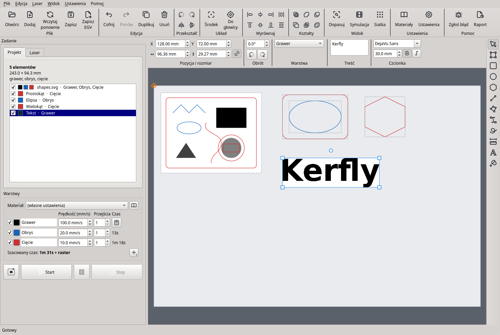
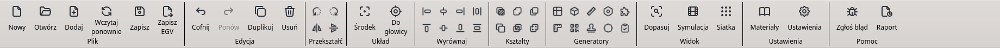
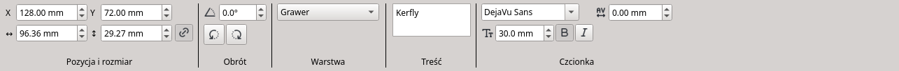
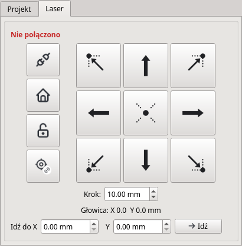
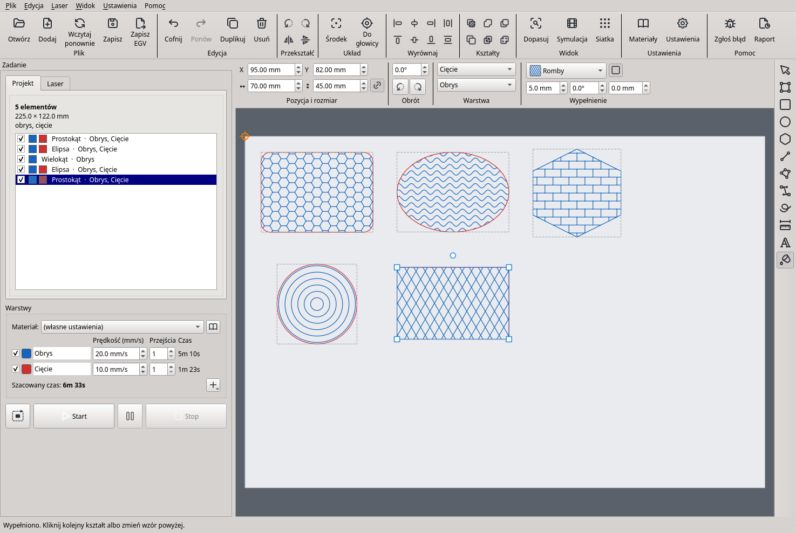
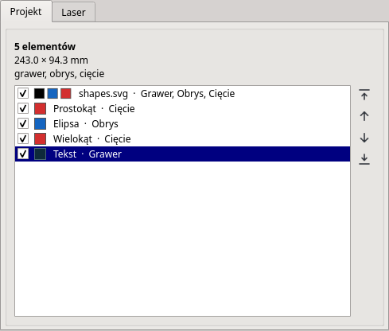
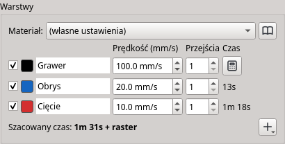

# Instrukcja obsługi Kerfly

Kerfly steruje laserami CO2 klasy K40 z płytami Lihuiyu (rodzina M2 Nano):
układa projekty na stole lasera, pozwala je rysować i edytować oraz wysyła
zadanie do lasera. Instrukcja dotyczy wersji 0.16.

> Kerfly jest we wczesnej fazie rozwoju. Pierwszy test na prawdziwym laserze
> odbył się w listopadzie 2026. Funkcje oznaczone *(jeszcze nie sprawdzone na
> laserze)* działają w programie i w testach, ale nie były jeszcze
> uruchamiane na sprzęcie. Zawsze trzymaj rękę przy wyłączniku lasera.

- [1. Pierwsze uruchomienie](#s1)
- [2. Okno programu](#s2)
- [3. Przesuwanie głowicy](#s3)
- [4. Otwieranie plików](#s4)
- [5. Rysowanie i edycja](#s5)
- [6. Warstwy i materiały](#s6)
- [7. Uruchamianie zadania](#s7)
- [8. Ustawienia](#s8)
- [9. Skróty klawiszowe](#s9)
- [10. Gdy coś nie działa](#s10)

## 1. Pierwsze uruchomienie

1. Zainstaluj Kerfly według
   [instrukcji instalacji](https://github.com/cyryllo/Kerfly/blob/main/INSTALL_pl.md).
   Uruchamiasz go przez `start_kerfly.bat` (Windows) albo `./start_kerfly.sh`
   (Linux).
2. Sprawdź instalację: `start_kerfly.bat --self-test` albo
   `./start_kerfly.sh --self-test`. Każda linia powinna mieć `OK`; linie
   `WARN` dotyczą rzeczy opcjonalnych albo niepodłączonego lasera.
3. Otwórz **Ustawienia → Ustawienia… → Maszyna** i wybierz **Płytę
   sterującą** (napis na płycie, np. LASER-M2 albo LASER-M3), **jednostki** i
   **rozmiar stołu**.
4. Włącz laser, podłącz kabel USB i naciśnij przycisk z **wtyczką** (Połącz z
   laserem, Ctrl+I) na zakładce **Laser**. Domyślnie Kerfly od razu bazuje
   głowicę (przesuwa ją do lewego górnego rogu).

Kerfly czyta i zapisuje ten sam plik ustawień co K40 Whisperer
(`k40_whisperer.txt` w folderze domowym), więc działa z Twoimi ustawieniami
z K40 Whisperera. Zmienione ustawienia zachowasz przez **Plik → Zapisz
ustawienia jako domyślne**.

## 2. Okno programu

- **Pasek narzędzi** (góra): polecenia pliku, edycji, układu, widoku,
  ustawień i pomocy w opisanych grupach.

  

- **Pasek opcji** (pod paskiem narzędzi): pozycja, rozmiar i obrót
  zaznaczonego elementu, jego warstwa i opcje zaznaczonego kształtu albo
  narzędzia (np. tekst i czcionka).

  

- **Panel po lewej**: zakładka **Projekt** to lista elementów na stole,
  zakładka **Laser** przesuwa głowicę. Pod zakładkami są **Warstwy** i
  przyciski zadania (objazd konturu, start, pauza, stop).
- **Stół** (środek): stół lasera z Twoimi elementami. Pomarańczowy celownik
  to głowica lasera. Elementy wystające poza stół są rysowane na czerwono i
  zadanie nie ruszy, dopóki ich nie przesuniesz z powrotem.
- **Narzędzia rysowania** (prawa strona): zaznaczanie, edycja węzłów,
  prostokąt, elipsa, wielokąt, linia, łamana, pióro, rysowanie odręczne,
  miarka, tekst, wypełnienie wzorem.

Mysz na stole: kółko przybliża i oddala (nie dalej niż cały stół); środkowy
albo prawy przycisk przesuwa widok; **Ctrl+0** dopasowuje stół do okna.

## 3. Przesuwanie głowicy

Na zakładce **Laser** po lewej są przyciski maszyny, a po prawej strzałki.

| Przycisk | Co robi |
|---|---|
| Wtyczka | Połącz z laserem (Ctrl+I) |
| Domek | **Bazowanie**: przesuwa głowicę do pozycji bazowej |
| Otwarta kłódka | **Odblokuj osie**: zwalnia silniki, żeby przesunąć głowicę ręką |
| Celownik z łańcuchem | **Projekt podąża za głowicą** (Ctrl+Alt+H), opis niżej |
| Strzałki | Przesuwają głowicę o jeden **Krok** (pole pod strzałkami). **Ctrl+strzałki** na klawiaturze robią to samo |
| Kropkowane narożniki i środek | Przesuwają głowicę do tego narożnika albo środka projektu, żeby zobaczyć, gdzie będzie cięcie. Projekt się nie przesuwa. Ctrl+7, Ctrl+9, Ctrl+5, Ctrl+1, Ctrl+3 |
| Idź do X / Y, **Idź** | Bazuje, a potem jedzie głowicą do tej pozycji (odległość od pozycji bazowej; Ctrl+G) |

Same strzałki na klawiaturze (bez Ctrl) przesuwają **zaznaczony element** na
stole, nie głowicę.

**Gdzie zaczyna się zadanie.** Projekt zostaje tam, gdzie leży na stole (jak w
LightBurnie czy MeerK40t): na początku zadania głowica najpierw podjeżdża do
projektu. Jeśli wolisz sposób pracy z K40 Whisperera, w którym projekt zaczyna
się przy głowicy:

- **Edycja → Ustaw projekt przy głowicy** (Ctrl+H, na pasku **Do głowicy**)
  jednorazowo przesuwa projekt do głowicy.
- **Projekt podąża za głowicą** (przycisk z łańcuchem, zielony po
  włączeniu) trzyma projekt przy głowicy: strzałki, Idź do X/Y i Bazowanie
  przesuwają głowicę razem z projektem, a strzałki nie wypchną projektu poza
  stół. Przyciski narożników nadal przesuwają tylko głowicę. *(jeszcze nie
  sprawdzone na laserze)*

K40 nie podaje, gdzie jest głowica. Kerfly liczy ruchy, które wysłał; po
odblokowaniu osi, ręcznym przesunięciu głowicy albo zatrzymaniu zadania
naciśnij **Bazowanie** przed następnym zadaniem. Po zatrzymanym zadaniu
Kerfly przypomina o tym na pasku stanu.

## 4. Otwieranie plików

**Plik → Otwórz projekt…** (Ctrl+O) zastępuje wszystko na stole;
**Plik → Dodaj projekt…** (Ctrl+Shift+O) kładzie kolejny plik obok
pozostałych.

| Plik | Co z niego powstaje |
|---|---|
| SVG | Czerwone linie są cięte, niebieskie grawerowane jako obrys, a cała reszta (wypełnienia, obrazy, czarne linie) grawerowana rastrowo, jak w K40 Whisperer. Kerfly używa Inkscape, jeśli jest zainstalowany, a bez niego własnego renderera; Inkscape jest potrzebny do tekstu w SVG, który ma być cięty albo grawerowany jako obrys |
| DXF | Linie cięcia; niebieskie obiekty i warstwy o nazwie *engrave* to obrys |
| PNG, JPG, BMP, TIFF, GIF, WebP | Grawer rastrowy: ciemne piksele są grawerowane. Kerfly pokazuje rozmiar obrazu; ustaw rozdzielczość albo szerokość i wysokość |
| G-code (.ngc, .gcode, .nc, .g, .tap) | Wykonywany jako G-code |
| Projekt Kerfly (.kerfly) | Cały układ, warstwy i narysowane kształty |

**Plik → Zapisz projekt** (Ctrl+S) zapisuje układ, warstwy, narysowane
kształty i kopie otwartych plików w jednym pliku `.kerfly`, który łatwo
przenieść na komputer przy laserze. **Wczytaj projekt ponownie** (F5) czyta
otwarte pliki jeszcze raz po zmianach w innym programie.

## 5. Rysowanie i edycja

Wybierz narzędzie po prawej (albo naciśnij jego klawisz) i rysuj myszą na
stole. Opcje narzędzia są na pasku opcji; możesz je zmienić przed
narysowaniem i po nim.

| Narzędzie | Klawisz | Jak |
|---|---|---|
| Zaznacz i przesuń | S | Klik zaznacza, przeciąganie przesuwa; uchwyty skalują i obracają. Ramka wokół kilku elementów albo Ctrl+klik zaznacza kilka |
| Edytuj węzły | N | Przeciągaj węzły i okrągłe uchwyty krzywych (Ctrl: jeden uchwyt osobno). Dwuklik na boku dodaje węzeł, na węźle go usuwa. Klawisze: I wstaw, D usuń, L linia, C krzywa, O gładki, S symetryczny, Z zamknij / otwórz, B rozdziel |
| Prostokąt | R | Przeciągnij. Shift: kwadrat. Opcja: promień rogów |
| Elipsa | E | Przeciągnij. Shift: koło |
| Wielokąt | P | Przeciągnij. Opcja: liczba boków |
| Linia | L | Przeciągnij. Shift: co 45° |
| Łamana | Shift+L | Klikaj narożniki. Klik w pierwszy punkt zamyka; dwuklik albo Enter kończy otwartą linię; Backspace usuwa ostatni narożnik; Esc anuluje |
| Pióro (krzywe) | B | Klik daje narożnik, wciśnięcie i przeciągnięcie gładką krzywą. Klik w pierwszy punkt zamyka; dwuklik albo Enter kończy |
| Odręcznie | F | Rysuj z wciśniętym przyciskiem; skończ blisko początku, żeby zamknąć kształt |
| Miarka | M | Przeciągnij między dwoma punktami: odległość, szerokość, wysokość i kąt |
| Tekst | T | Kliknij i wpisz tekst w polu **Treść**; wybierz czcionkę, rozmiar, pogrubienie i kursywę |
| Wypełnij wzorem | Shift+F | Wybierz wzór na pasku opcji i klikaj zamknięte kształty, żeby je wypełnić (opis niżej) |

**Przyciąganie.** Rysowanie i przesuwanie przyciąga do narożników, środków i
krawędzi innych elementów i do stołu (**Widok → Przyciągaj do obiektów**,
Ctrl+;) oraz do siatki, gdy jest włączona (**Widok → Przyciągaj do siatki**,
Ctrl+'; **Widok → Rozmiar siatki**). Przytrzymaj **Alt**, żeby na chwilę nic
nie przyciągało.

**Dokładne przesuwanie.** Wpisz pozycję, rozmiar i kąt na pasku opcji
(przycisk z łańcuchem zachowuje proporcje) albo użyj strzałek: 1 mm albo
jedno oczko siatki, z Shiftem 10 razy dalej.

**Układanie.** Menu **Edycja** i pasek narzędzi mają: cofnij i ponów
(Ctrl+Z, Ctrl+Shift+Z), duplikuj (Ctrl+D), usuń (Del), obrót o 90° (Ctrl+L,
Ctrl+R), odbicie (Ctrl+Shift+H, Ctrl+Shift+V), wyśrodkowanie na stole
(Ctrl+E), wyrównywanie i rozkładanie oraz **Łącz kształty**: sumę, różnicę,
część wspólną i wykluczenie zamkniętych kształtów.

**Grupy.** **Grupuj** (Ctrl+Shift+G) sprawia, że kilka elementów przesuwa
się razem; klik w jeden z nich zaznacza całą grupę, drugi klik tylko ten
element. **Rozgrupuj** (Ctrl+Alt+G) dzieli grupę, a także otwarty plik SVG
albo DXF: każda jego linia staje się kształtem do edycji, a obrazy dzielą się
na osobne części. Dwuklik na dowolnym elemencie otwiera edycję węzłów.

**Kreskowanie (wypełnienie liniami).** Przenieś zamknięty kształt na warstwę
obrysu (opis niżej) i naciśnij **Wypełnij liniami** w sekcji **Kreskowanie**
na pasku opcji. Ustaw odstęp linii, ich kąt i **#** dla drugiej warstwy linii
pod kątem 90°. Dziury w kształcie zostają puste.

**Wypełnienia wzorami.** *(jeszcze nie sprawdzone na laserze)* Narzędzie
**Wypełnij wzorem** (wiaderko, Shift+F) wypełnia zamknięte kształty
grawerowanymi liniami we wzór: linie, krzyżowe, fale, zygzak, okręgi, plaster
miodu, romby albo cegły.

1. Wybierz narzędzie i wzór w sekcji **Wypełnienie** na pasku opcji. Ustaw
   jego rozmiar (odstęp między liniami), kąt i margines, czyli wolne miejsce
   wewnątrz obrysu.
2. Kliknij zamknięty kształt na warstwie cięcia albo obrysu. Klikaj kolejne,
   żeby też je wypełnić; zaznaczone kształty od razu dostają wybrany wzór.
3. Obrys zostaje na swojej warstwie: kształt do cięcia dalej jest cięty, a wzór
   jest grawerowany na warstwie obrysu (dla kształtu do cięcia druga lista
   **Warstwa** wybiera, na której). Kwadratowy przycisk obok listy wzorów
   wyłącza obrys, wtedy graweruje się sam wzór.

Zaznaczony kształt pokazuje tę samą sekcję **Wypełnienie** także przy
narzędziu zaznaczania: tam zmienisz wzór albo wybierzesz **Bez wzoru**, żeby go
usunąć. Dziury w kształcie (np. w literach) zostają puste. Otwarty plik SVG
albo DXF trzeba najpierw rozgrupować (Edycja → Rozgrupuj), żeby jego linie
stały się kształtami.

**Mostki.** Zamknięty kształt na warstwie cięcia może mieć małe nieprzecięte
mostki, które trzymają element w arkuszu: ustaw ich liczbę i szerokość w
sekcji **Mostki**.

**Lista elementów.** Zakładka **Projekt** pokazuje wszystkie elementy z
kolorami ich warstw. Klik w wiersz zaznacza element na stole (Ctrl / Shift:
kilka); odznaczenie pola wyłącza element z zadania.

## 6. Warstwy i materiały

Każdy element ma do trzech części: **grawer** (rastrowy: obrazy i
wypełnienia), **obrys** (grawer wektorowy) i **cięcie**. Każda część trafia na
**warstwę**. Warstwa ma własną prędkość, liczbę przejść, moc (płyty M3 z
regulacją mocy) i kolor. Odznaczona warstwa nie wchodzi do zadania.

- **Warstwa decyduje, co robi laser.** Zaznacz narysowany kształt i wybierz
  jego warstwę na liście **Warstwa** na pasku opcji: warstwa cięcia go
  wycina, warstwa obrysu graweruje jego obrys (albo kreskuje), warstwa
  graweru go wypełnia.
- **Więcej warstw.** Przycisk **+** pod warstwami dodaje kolejną warstwę
  cięcia, obrysu albo graweru, np. drugą warstwę cięcia z inną prędkością.
  Warstwy wykonują się w kolejności: grawer, obrys, cięcie.
- **Czas.** Kolumna **Czas** pokazuje czas każdej warstwy; dla graweru
  naciśnij przycisk z kalkulatorem. **Widok → Symulacja zadania…**
  (Ctrl+Shift+J) odtwarza ruchy głowicy na stole.
- **Materiały.** **Ustawienia → Baza materiałów…** zapamiętuje prędkości,
  przejścia i moce dla materiałów (np. „Sklejka 3 mm”). Wybór materiału z
  listy **Materiał** nad warstwami ustawia wszystkie warstwy naraz. Bazę można
  eksportować i importować, żeby się nią dzielić.

## 7. Uruchamianie zadania

1. Połącz laser i zbazuj głowicę, włóż materiał i ustaw ostrość.
2. Ułóż projekt na stole (albo włącz „Projekt podąża za głowicą”, punkt 3).
3. **Objazd konturu** (przycisk z kreskowaną ramką, menu Laser) objeżdża
   głowicą projekt, z wyłączonym laserem, chyba że ustawisz inaczej w
   ustawieniach, żeby sprawdzić, gdzie będzie cięcie. Zaczyna od narożnika
   najbliższego głowicy.
4. **Start** (F9) wykonuje wszystkie zaznaczone warstwy. **Pauza** na chwilę
   zatrzymuje laser, a ten sam przycisk wznawia pracę. **Stop** (Esc)
   natychmiast kończy zadanie; potem naciśnij **Bazowanie** przed następnym
   zadaniem.
5. Pasek postępu na dole pokazuje procent bieżącego kroku (przygotowanie
   danych, wysyłanie do lasera).

**Kontrola bezpieczeństwa.** Zanim cokolwiek zostanie wysłane, Kerfly
sprawdza, czy głowica przez całe zadanie i objazd zostaje na stole. Jeśli
wyjechałaby poza stół o więcej niż 1 mm, nic nie zostanie wysłane, a pasek
stanu poda krawędź i odległość. *(jeszcze nie sprawdzone na laserze)*

**Strzał testowy** (płyty M3, zakładka Laser): krótko odpala laser z mocą i
czasem ustawionymi obok przycisku.

**Pliki EGV.** **Plik → Zapisz plik EGV…** zapisuje zadanie do pliku (nie
przy mocy ustawianej dla każdej operacji na M3); **Plik → Wyślij plik EGV do
lasera…** wysyła istniejący plik EGV.

## 8. Ustawienia

**Ustawienia → Ustawienia…** (Ctrl+,) mają pięć zakładek:

| Zakładka | Ustawienia |
|---|---|
| Maszyna | płyta sterująca, jednostki, rozmiar stołu, pozycja bazowa w prawym górnym rogu, bazowanie przy łączeniu, odblokowanie osi i sygnał po zadaniu, współczynniki skali X/Y, moc dla każdej operacji i moc maksymalna na M3 |
| Raster | półtony (dithering) i ich rozdzielczość, odwrócenie kolorów, odbicie, obrót o 90°, grawer od dołu do góry, odstęp linii skanowania, krzywa poziomów |
| Wektory | najpierw kształty wewnętrzne, objazd konturu z włączonym laserem, odstęp i prędkość objazdu |
| Oś obrotowa | oś obrotowa, jej współczynnik skali i prędkość szybkich ruchów |
| Zaawansowane | język (po ponownym uruchomieniu), Inkscape, mniejsze zużycie pamięci, przygotowanie danych USB, czekanie na laser, limit czasu i ponowienia USB |

Kerfly jest dostępny po angielsku, polsku, niemiecku, hiszpańsku i
francusku.

## 9. Skróty klawiszowe

| Klawisze | Działanie |
|---|---|
| Ctrl+O / Ctrl+Shift+O | Otwórz projekt / dodaj projekt |
| F5 | Wczytaj projekt ponownie |
| Ctrl+S / Ctrl+Shift+S | Zapisz projekt / zapisz projekt jako |
| Ctrl+Shift+E | Zapisz plik EGV |
| Ctrl+Z / Ctrl+Shift+Z | Cofnij / ponów |
| Ctrl+D / Del | Duplikuj / usuń |
| Ctrl+L / Ctrl+R | Obróć o 90° w lewo / w prawo |
| Ctrl+Shift+H / Ctrl+Shift+V | Odbij w poziomie / w pionie |
| Ctrl+Shift+G / Ctrl+Alt+G | Grupuj / rozgrupuj |
| Ctrl+E | Wyśrodkuj na stole |
| Ctrl+H | Ustaw projekt przy głowicy |
| Ctrl+Alt+H | Projekt podąża za głowicą (wł. / wył.) |
| Strzałki (Shift: ×10) | Przesuń zaznaczony element |
| Ctrl+strzałki | Przesuń głowicę o jeden krok |
| Ctrl+7, 9, 5, 1, 3 | Głowica do lewego górnego, prawego górnego rogu, środka, lewego dolnego, prawego dolnego rogu projektu |
| Ctrl+G | Idź do pozycji X/Y |
| Ctrl+I | Połącz z laserem |
| Home | Bazowanie |
| F9 / Esc | Start / stop |
| Ctrl+0 | Dopasuj stół do okna |
| Ctrl+Shift+J | Symulacja zadania |
| Ctrl+' / Ctrl+; | Przyciągaj do siatki / do obiektów |
| Alt (przytrzymany) | Chwilowo bez przyciągania |
| Ctrl+, | Ustawienia |
| F1 | Ta instrukcja |
| S, N, R, E, P, L, Shift+L, B, F, M, T, Shift+F | Narzędzia rysowania (punkt 5) |

## 10. Gdy coś nie działa

**Pomoc → Instrukcja obsługi** (F1) otwiera tę instrukcję.

- **Pomoc → Zgłoś problem na GitHubie…** (na pasku **Zgłoś błąd**) zapisuje
  raport diagnostyczny i otwiera formularz zgłoszenia z wpisaną wersją,
  systemem i płytą. Przeciągnij plik raportu do pola *Diagnostic report*.
  Formularz jest po angielsku, ale możesz pisać po polsku. Potrzebne jest
  darmowe konto GitHub.
- **Pomoc → Zapisz raport diagnostyczny…** (na pasku **Raport**) tylko
  zapisuje raport: ustawienia, autotest i dziennik wszystkiego, co poszło do
  lasera.
- **Pomoc → Otwórz folder dziennika** pokazuje plik `kerfly.log`.

Częste problemy:

| Problem | Co zrobić |
|---|---|
| „Laser nie jest połączony” | Naciśnij przycisk z wtyczką (Ctrl+I). W Linuksie sprawdź regułę udev (instrukcja instalacji), w Windows sterownik libusb |
| Głowica jest gdzie indziej, niż pokazuje program | Naciśnij Bazowanie. Tak bywa po odblokowaniu osi, ręcznym przesunięciu głowicy i po Stop |
| Element jest czerwony, Start nie działa | Element wystaje poza stół: przesuń go z powrotem |
| Brakuje tekstu z SVG albo nie jest cięty | Zainstaluj Inkscape: zamienia tekst SVG na ścieżki |
| Laser przestał odpowiadać | **Laser → Odmroź laser**, potem **Zwolnij USB** i połącz ponownie |
